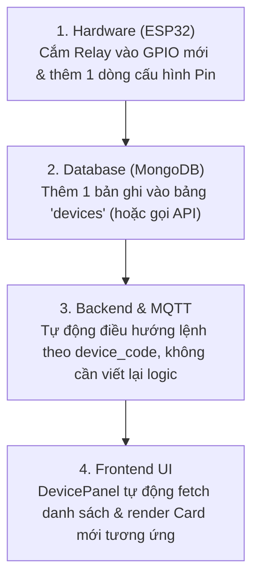

# Kế Hoạch Thiết Kế Kỹ Thuật Hệ Thống IoT PTIT (Bản Cập Nhật)

Tài liệu này điều chỉnh kế hoạch kỹ thuật cho toàn bộ hệ thống IoT PTIT căn cứ theo:
1. **Thực tế phần cứng:** Chỉ lắp **Đèn** (`LAMP_01`), **Quạt** (`FAN_01`) chưa lắp linh kiện thực tế.
2. **Giao diện Dashboard:** Vẫn hiển thị Card Quạt nhưng ở trạng thái **"Chưa kết nối / Disconnected"** (công tắc bị `disabled`), sẵn sàng cho kịch bản vấn đáp "Thêm thiết bị mới".
3. **Kiến trúc mở rộng (Extensible Architecture):** Thiết kế sẵn sàng từ DB, MQTT, Backend API đến Frontend UI và Firmware để trả lời xuất sắc câu hỏi của giảng viên: *"Nếu muốn thêm thiết bị thì làm thế nào?"*.
4. **Đặc tả Bộ lọc thời gian đa độ chính xác (`timestamp.md`):** Tích hợp chuẩn **Time Range Filter with Variable Precision** (DAY $\rightarrow$ HOUR $\rightarrow$ MINUTE $\rightarrow$ SECOND) cho trang Tra cứu dữ liệu cảm biến & Lịch sử hoạt động.

---

## User Review Required

> [!IMPORTANT]
> **Điểm cốt lõi cần xác nhận:**
> 1. **Thiết bị Quạt trên UI:** Card Quạt hiển thị badge màu xám/vàng cam nhạt *"Chưa kết nối"*, Switch bị vô hiệu hóa (disabled) kèm Tooltip *"Thiết bị chưa được kết nối phần cứng - Sẵn sàng cho module mở rộng"*.
> 2. **Kiến trúc cắm-và-chạy (Plug-and-Play):** Toàn bộ schema `devices`, MQTT payload, Backend Controller và Frontend DevicePanel được thiết kế dạng mảng động (dynamic list), không hardcode cố định 2 thiết bị.
> 3. **Bộ lọc thời gian theo `timestamp.md`:** Cho phép để trống Giờ/Phút/Giây. Granularity được tính tự động từ trường sâu nhất được nhập. Backend mở rộng query range `[start, end)` bao trọn khung thời gian.

---

## Chi Tiết Các Thay Đổi Kiến Trúc & Thiết Kế

### 1. Kiến Trúc Mở Rộng Thiết Bị (Trả Lời Thầy Giáo: "Thêm Thiết Bị Mới")

Để trả lời và minh họa trực tiếp cho câu hỏi của giảng viên khi kiểm tra/chấm đồ án, hệ thống áp dụng **Quy trình 4 bước mở rộng chuẩn Module**:



#### Chi tiết theo từng tầng:
- **Tầng Database (`Device.schema.js`):**
  ```javascript
  {
    device_code: "FAN_01",          // Mã định danh thiết bị
    device_name: "Quạt làm mát",     // Tên hiển thị
    device_type: "FAN",              // Loại icon: FAN, LAMP, PUMP, AC, etc.
    pin_relay: 27,                   // Chân GPIO dự kiến
    is_connected: false,             // false -> UI hiển thị 'Chưa kết nối' & Disable switch
    current_state: "OFF",            // ON / OFF
    is_active: true
  }
  ```
- **Tầng Firmware (ESP32 `config.h`):**
  - Khai báo mảng cấu trúc thiết bị dạng dynamic/config array:
    ```cpp
    struct DeviceConfig {
      const char* code;
      int pin;
      bool isConnected;
    };
    DeviceConfig devices[] = {
      { "LAMP_01", 26, true  },  // Đèn: Đã lắp phần cứng thực tế
      { "FAN_01",  27, false }   // Quạt: Cổng mở rộng (Reserved)
    };
    ```
- **Tầng Backend (`backend/src/controllers/device.controller.js`):**
  - Khi nhận toggle request `/api/devices/:device_code/toggle`:
    - Kiểm tra `device.is_connected`. Nếu `false` $\rightarrow$ Trả về lỗi `400 Bad Request: Thiết bị chưa được kết nối phần cứng`.
    - Nếu `true` $\rightarrow$ Đóng gói MQTT message gửi đến `esp32/device/command` với `deviceId: device_code`.
- **Tầng Frontend (`frontend/src/components/DevicePanel.jsx`):**
  - Render danh sách thiết bị bằng `devices.map()`.
  - Nếu `!device.is_connected`:
    - Hiển thị Tag Ant Design: `<Tag color="default">Chưa kết nối</Tag>`.
    - `<Switch disabled={true} />` kèm `<Tooltip title="Module chưa kết nối phần cứng. Có thể kích hoạt khi lắp thêm Relay">`.

---

### 2. Tích Hợp Đặc Tả Bộ Lọc Thời Gian (`timestamp.md`)

Áp dụng đầy đủ quy tắc lọc thời gian đa mức độ chính xác (**Variable Precision**) cho `DataSensorPage.jsx` và `ActionHistoryPage.jsx`:

#### Quy tắc xác định độ chính xác (Granularity Matrix):
| Date | Hour | Minute | Second | Granularity | Phạm vi query mở rộng $[Start, End)$ |
| :--- | :--- | :--- | :--- | :--- | :--- |
| ✓ | ✓ | ✓ | ✓ | `SECOND` | Giữ nguyên chính xác giây: `[YYYY-MM-DD HH:mm:ss, YYYY-MM-DD HH:mm:ss.999]` |
| ✓ | ✓ | ✓ | ✗ | `MINUTE` | Bao phủ trọn vẹn 1 phút: `[HH:mm:00, HH:mm:59.999]` |
| ✓ | ✓ | ✗ | ✗ | `HOUR` | Bao phủ trọn vẹn 1 giờ: `[HH:00:00, HH:59:59.999]` |
| ✓ | ✗ | ✗ | ✗ | `DAY` | Bao phủ trọn vẹn cả ngày: `[00:00:00, 23:59:59.999]` |

#### Quy tắc Validation:
- **Date** là trường bắt buộc.
- Nếu nhập `Second` $\rightarrow$ Bắt buộc phải có `Minute` và `Hour`.
- Nếu nhập `Minute` $\rightarrow$ Bắt buộc phải có `Hour`.
- **Không tự động điền `00`** vào các trường bỏ trống ở UI.
- Validate `Start Time <= End Time`.
- Chỉ thực hiện gửi API query khi người dùng bấm nút **`[ Cập nhật / Lọc dữ liệu ]`**.

---

## Proposed Changes

### Tài Liệu Kỹ Thuật (`docs/`)

#### [MODIFY] [ke_hoach_thiet_ke_ky_thuat.md](file:///d:/Giaotrinh/PTIT/07_Ky_1_Nam_4/Iot/docs/ke_hoach_thiet_ke_ky_thuat.md)
- Cập nhật phân mục Hardware: Đèn lắp thực tế, Quạt ở chế độ Module mở rộng.
- Cập nhật phân mục Frontend: Cấu hình `DevicePanel` hiển thị trạng thái Chưa kết nối / Disabled cho Quạt; Bổ sung đặc tả component `VariableTimeRangeFilter` theo `timestamp.md`.
- Cập nhật phân mục Database: Bổ sung trường `is_connected`, `device_type` vào `Device.schema.js`.
- Bổ sung mục chuyên đề: *"Kiến trúc mở rộng & Hướng dẫn trả lời vấn đáp khi thêm thiết bị mới"*.

---

### Frontend (`frontend/`)

#### [NEW] `frontend/src/components/VariableTimeRangeFilter.jsx`
- Component bộ lọc thời gian tách biệt 4 trường (Date, Hour, Minute, Second) cho cả Start & End.
- Validation liên tục (Cascade validation: Giây cần Phút & Giờ).
- Xác định `granularity` gửi kèm API payload.

#### [NEW] `frontend/src/components/DevicePanel.jsx`
- Danh sách card điều khiển thiết bị:
  - **Đèn (`LAMP_01`):** Trạng thái Online, Switch toggle kèm spin loading chờ ACK từ MQTT, hiệu ứng Glow cam/vàng khi ON.
  - **Quạt (`FAN_01`):** Trạng thái Disconnected, Badge xám "Chưa kết nối", Switch disable, Tooltip thông báo lý do.

#### [MODIFY] `frontend/src/pages/DashboardPage.jsx`
- Tích hợp `DevicePanel` với trạng thái mới.

#### [MODIFY] `frontend/src/pages/DataSensorPage.jsx` & `ActionHistoryPage.jsx`
- Tích hợp `VariableTimeRangeFilter`.

---

### Backend & Database (`backend/` & `database/`)

#### [MODIFY] `database/schemas/Device.schema.js`
- Bổ sung `is_connected: { type: Boolean, default: true }`, `device_type: { type: String, default: 'LAMP' }`.

#### [MODIFY] `database/seeders/run-all-seeds.js`
- Seed `LAMP_01` với `is_connected: true`.
- Seed `FAN_01` với `is_connected: false`.

#### [MODIFY] `backend/src/controllers/sensorData.controller.js` & `actionHistory.controller.js`
- Hỗ trợ parser query range theo `granularity` (`DAY`, `HOUR`, `MINUTE`, `SECOND`) theo chuẩn `timestamp.md`.

---

### Hardware (`hardware/`)

#### [MODIFY] `hardware/schematics/pin-mapping.md`
- Ghi rõ `GPIO 26` kết nối Relay Đèn thật.
- Ghi rõ `GPIO 27` là chân dự phòng cho Module Quạt (kèm sơ đồ đấu nối khi mở rộng).

---

## Verification Plan

### Automated & Manual Verification
1. **Kiểm tra Frontend UI:**
   - Mở Dashboard: Đèn hiển thị công tắc hoạt động bình thường, Quạt hiển thị tag "Chưa kết nối" và switch bị khóa.
   - Thử nghiệm bộ lọc thời gian:
     - Nhập Date only $\rightarrow$ Request gửi `granularity: "DAY"`, kết quả trả về dữ liệu 24 giờ trong ngày.
     - Nhập Date + Hour + Minute $\rightarrow$ Request gửi `granularity: "MINUTE"`, kết quả trả về dữ liệu trong khoảng 1 phút.
     - Bỏ trống Minute nhưng nhập Second $\rightarrow$ Báo lỗi validation ngay trên UI mà không gọi API.
2. **Kiểm tra Kịch bản mở rộng thiết bị (Thuyết trình BTL):**
   - Đổi `is_connected` của Quạt thành `true` trong DB hoặc qua seed $\rightarrow$ Quạt lập tức chuyển sang trạng thái hoạt động trên UI mà không cần sửa code.
