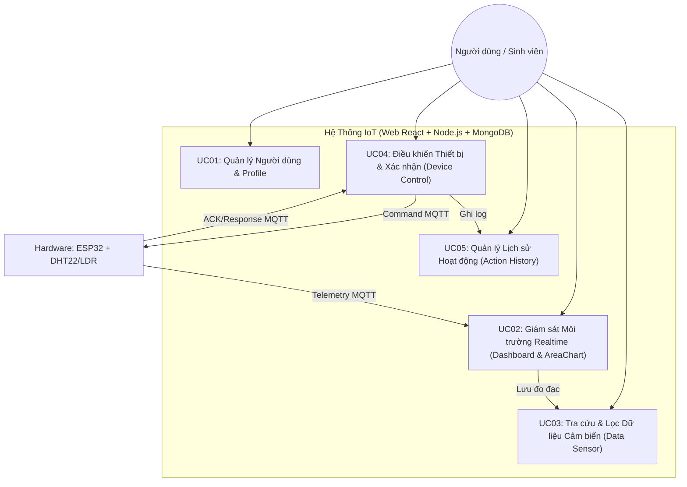
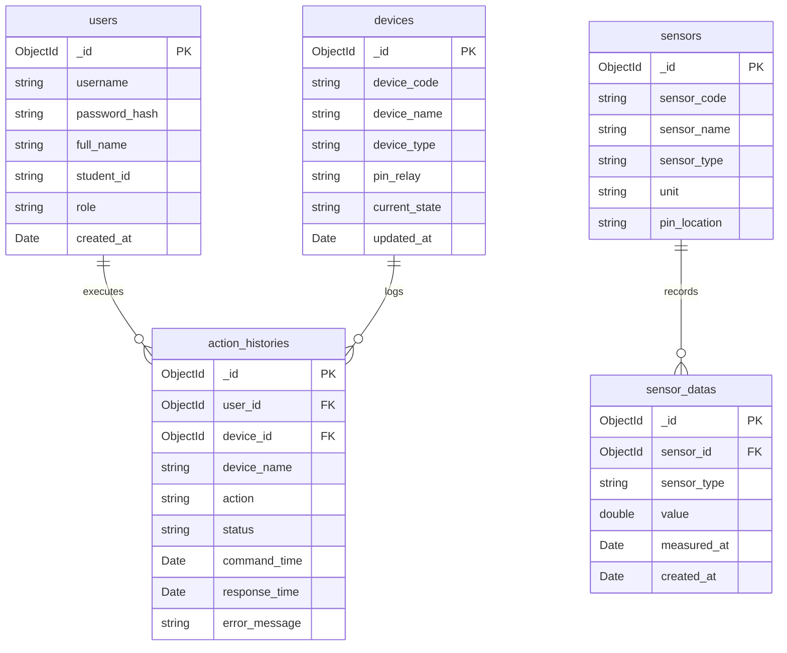

# TÀI LIỆU YÊU CẦU & ĐẶC TẢ HỆ THỐNG IOT CHUẨN BTL PTIT (SRS & TECH SPEC)

> **Mã tài liệu:** `SPEC-IOT-PTIT-2026`  
> **Căn cứ tài liệu gốc:** `IoT_SRS_BA_Guide_PTIT.docx`  
> **Kiến trúc lựa chọn:** Node.js (Express) + React (Ant Design / Lucide) + MongoDB (Mongoose) + ESP32/DHT22 + MQTT

---

## 1. TỔNG QUAN & PHẠM VI HỆ THỐNG

### 1.1. Mục tiêu (Objective)
Xây dựng một hệ thống IoT End-to-End hoàn chỉnh phục vụ giám sát môi trường và điều khiển thiết bị thông minh theo thời gian thực, đáp ứng đầy đủ tiêu chuẩn đánh giá Bài tập lớn ngành CNTT/ATTT - Học viện Công nghệ Bưu chính Viễn thông (PTIT).

### 1.2. Tech Stack lựa chọn
* **Hardware & Firmware:**
  - Vi điều khiển: **ESP32** (NodeMCU-32S / ESP-WROOM-32).
  - Cảm biến: **DHT22** (Nhiệt độ, Độ ẩm độ chính xác cao) + **LDR/Photoresistor** (Cường độ ánh sáng).
  - Cơ cấu chấp hành (Actuators): **Relay Module** (điều khiển Đèn/Quạt/Thiết bị 220V/5V), Đèn LED cảnh báo.
  - Giao thức: **MQTT (v3.1.1/v5.0)** qua Wi-Fi (PubSubClient / MQTT library).
* **MQTT Broker:** Mosquitto / EMQX Broker / HiveMQ Cloud.
* **Backend Layer:**
  - Framework: **Node.js (Express.js)**.
  - Realtime: **Socket.io** (truyền dữ liệu cảm biến & trạng thái thiết bị lên Web theo thời gian thực).
  - MQTT Client: **MQTT.js** (subcribe dữ liệu đo telemetry và publish lệnh điều khiển command).
  - Database Driver / ODM: **Mongoose (MongoDB)**.
* **Database Layer:** **MongoDB** (Lưu trữ linh hoạt, hỗ trợ Time-Series / Query hiệu năng cao cho dữ liệu cảm biến IoT).
* **Frontend Web Application:**
  - Framework: **React (Vite)**.
  - UI Library (hạn chế tối đa CSS tay, thẩm mỹ hiện đại): **Ant Design (antd)** + **Lucide Icons**.
  - Trực quan hóa dữ liệu biểu đồ: **Recharts (AreaChart với Gradient Fill)**.
  - Cơ chế cập nhật biểu đồ: **Tự động reload / refresh lại dữ liệu AreaChart sau mỗi 5 giây (Component-level Polling/Socket reload mà KHÔNG reload lại toàn bộ trang web)**.

---

## 2. 5 USE CASES NGHIỆP VỤ BẮT BUỘC (CORE BUSINESS USE CASES)

Theo đúng quy định chuẩn của giảng viên, hệ thống được cấu trúc xoay quanh 5 Use Cases nghiệp vụ chính:

---

### Chi tiết 5 Use Case chuẩn BA/SRS:

### 2.1. UC01: Xác thực & Quản lý Thông tin Cá nhân (Authentication & Profile)
* **Mục tiêu:** Cho phép người dùng đăng nhập hệ thống và xem thông tin sinh viên làm BTL.
* **Màn hình liên quan:** `Login`, `Profile`.
* **Yêu cầu chi tiết:**
  - `FR-AUTH-01`: Đăng nhập bằng Username/Password, bảo mật mã hóa mật khẩu (Bcrypt hashing), tạo JWT token.
  - `FR-PROF-01`: Trang Profile hiển thị thông tin sinh viên (Họ tên, Mã sinh viên, Lớp, Ảnh đại diện, Giới thiệu BTL).
  - `FR-PROF-02`: Đầy đủ liên kết tới: **GitHub Repository**, **Figma Design**, **Swagger/Postman API Docs**, và **Link tải Báo cáo PDF**.

### 2.2. UC02: Giám sát Môi trường Thời gian thực (Realtime Dashboard & AreaChart)
* **Mục tiêu:** Hiển thị tức thời chỉ số nhiệt độ, độ ẩm, ánh sáng và đồ thị xu hướng dạng vùng (AreaChart) tự động làm mới.
* **Màn hình liên quan:** `Dashboard`.
* **Yêu cầu chi tiết:**
  - `FR-DASH-01`: 3 Widget/Card đo đạc: Nhiệt độ (°C), Độ ẩm (%), Ánh sáng (Lux).
  - `FR-DASH-02`: popup cảnh báo khi vượt ngưỡng an toàn (ví dụ: Nhiệt độ > 35°C cảnh báo đỏ).
  - `FR-DASH-03`: Biểu đồ vùng **AreaChart (Recharts với hiệu ứng dải màu Gradient)** hiển thị trực quan biến thiên của Nhiệt độ, Độ ẩm, Ánh sáng.
  - `FR-DASH-04`: **Cơ chế Auto-reload Biểu đồ 5s:** AreaChart tự động kích hoạt truy vấn dữ liệu mới nhất sau mỗi **5 giây** độc lập (chỉ làm mới biểu đồ mượt mà, không giật lag và không reload lại toàn bộ trang web).
  - `FR-DASH-05`: Widget điều khiển nhanh công tắc thiết bị (Đèn, Quạt, Relay) ngay trên Dashboard.
  - `FR-DASH-06`: Hiển thị trạng thái kết nối MQTT/ESP32 (Online/Offline indicator).
  - **Sidebar:** Menu điều hướng bên trái.
- **Top bar:** Hiển thị số liệu thời gian thực của các cảm biến (Nhiệt độ, Độ ẩm, Ánh sáng).
- **Biểu đồ:** Nằm bên dưới Top bar, vẽ biểu đồ dạng đường (Line chart) thể hiện sự dao động của các cảm biến trên theo thời gian thực.
- **Điều khiển (Góc phải):** Khu vực chứa các thiết bị (Quạt, Bóng đèn). 
  - **Yêu cầu UI/UX:** Khi bấm bật/tắt phải có **hiệu ứng loading**. Trạng thái chỉ thay đổi khi nhận được gói tin phản hồi từ phần cứng (để chắc chắn thiết bị đã được bật/tắt thành công).

### 2.3. UC03: Tra cứu & Lọc Dữ liệu Cảm biến (Data Sensor History)
* **Mục tiêu:** Cung cấp bảng dữ liệu lịch sử các lần đo của cảm biến phục vụ thống kê, phân tích.
* **Màn hình liên quan:** `Data Sensor`.
* **Yêu cầu chi tiết:**
  - `FR-DATA-01`: Bảng dữ liệu hiển thị: ID, Tên cảm biến / Loại đo, Giá trị (Value), Đơn vị, Thời gian đo (Timestamp).
  - `FR-DATA-02`: Mặc định sắp xếp theo **thời gian giảm dần (thời gian mới nhất lên đầu)**.
  - `FR-DATA-03`: Phân trang (Pagination) mượt mà bằng Ant Design Table.
  - `FR-DATA-04`: Bộ lọc & Tìm kiếm MongoDB backend:
    - Lọc theo loại cảm biến (Nhiệt độ / Độ ẩm / Ánh sáng).
    - Tìm kiếm/lọc theo khoảng giá trị (Value Range: Min - Max).
    - Lọc theo khoảng thời gian chính xác (Date/Time Range: Từ ngày/giờ đến ngày/giờ).
- **Chức năng tìm kiếm (Top):**
  - Dropdown list chọn loại dữ liệu: Tất cả, Nhiệt độ, Độ ẩm, Ánh sáng. Nếu chọn "Nhiệt độ", bảng dưới chỉ hiện dữ liệu nhiệt độ.
  - Input tìm kiếm theo thời gian: Hỗ trợ tìm chính xác (Giờ:Phút:Giây). Nếu người dùng xóa phần giây -> tìm theo Phút; xóa Phút -> tìm theo Giờ; xóa Giờ -> tìm theo Ngày.

### 2.4. UC04: Điều khiển Thiết bị & Phản hồi Trạng thái (Device Control with ACK)
* **Mục tiêu:** Bật/Tắt thiết bị phần cứng từ xa và nhận phản hồi xác thực trạng thái từ ESP32.
* **Quy tắc cốt lõi (Tránh lỗi trừ điểm của thầy):** Không được coi việc người dùng click nút "ON" là thiết bị đã ON. Phải có cơ chế xác nhận (ACK).
* **Yêu cầu chi tiết:**
  - `FR-DEV-01`: Người dùng bấm toggle Switch (Antd Switch) $\rightarrow$ UI hiển thị trạng thái `Pending / Đang xử lý...`.
  - `FR-DEV-02`: Backend gửi lệnh MQTT tới topic `esp32/device/command`.
  - `FR-DEV-03`: ESP32 nhận lệnh, kích hoạt Relay, sau đó publish lại gói tin xác nhận vào `esp32/device/ack`.
  - `FR-DEV-04`: Backend nhận ACK $\rightarrow$ cập nhật MongoDB trạng thái `SUCCESS` $\rightarrow$ bắn Socket.io sang Frontend $\rightarrow$ UI chuyển sang màu xanh `ON/OFF`.
  - `FR-DEV-05`: Xử lý Timeout (sau 3-5 giây nếu ESP32 mất kết nối / không phản hồi $\rightarrow$ báo lỗi `TIMEOUT / FAILED` và trả công tắc về trạng thái cũ).
  - **Điều khiển (Góc phải):** Khu vực chứa các thiết bị (Quạt, Bóng đèn). 
  - **Yêu cầu UI/UX:** Khi bấm bật/tắt phải có **hiệu ứng loading**. Trạng thái chỉ thay đổi khi nhận được gói tin phản hồi từ phần cứng (để chắc chắn thiết bị đã được bật/tắt thành công).
  - **UC 4 có các nút bật tắt này sẽ có phần giao diện nằm ngay góc phải/ hoặc 1/3 bên phải màn hình Dashboard.**(tùy bạn thiết kế sao cho thân thiện với người dùng)
  - nhớ là khi bật đèn xong thì sẽ hiện lên thông báo là xác nhận đèn đã được bật được gửi về từ cảm biến, và có nút xem chi tiết, màn hình tự chuyển đến uc5.
  - **Lưu ý:** nếu thiết bị không phản hồi hoặc bất kỳ trường hợp không thành công nào thì cũng cần hiện thị rõ thông báo lên màn hình cho người dùng biết.

### 2.5. UC05: Quản lý & Tra cứu Lịch sử Tác động (Action History)
* **Mục tiêu:** Nhật ký kiểm toán (Audit Log) toàn bộ các thao tác bật/tắt thiết bị của người dùng.
* **Màn hình liên quan:** `Action History`.
* **Yêu cầu chi tiết:**
  - `FR-HIS-01`: Bảng lịch sử gồm: ID, Tên người dùng, Tên thiết bị, Hành động (Bật/Tắt), Thời điểm gửi lệnh (Command Time), Thời điểm nhận phản hồi (Response Time), Trạng thái kết quả (Thành công / Thất bại / Timeout).
  - `FR-HIS-02`: Sắp xếp mặc định theo thời gian mới nhất giảm dần.
  - `FR-HIS-03`: Phân trang & Tìm kiếm/Lọc theo tên thiết bị, trạng thái (Success/Failed), và khoảng thời gian.

---

## 3. THIẾT KẾ CƠ SỞ DỮ LIỆU MONGODB (MONGOOSE SCHEMAS)

Cấu trúc 5 Collections trong MongoDB:

---

## 4. ĐẶC TẢ GIAO THỨC MQTT & API SPECIFICATION

### 4.1. MQTT Topic & Payload Structure
| Topic | Hướng truyền (Direction) | Mục đích | Cấu trúc Payload (JSON) |
| :--- | :--- | :--- | :--- |
| `esp32/telemetry` | ESP32 $\rightarrow$ Backend (Pub/Sub) | Gửi dữ liệu định kỳ (mỗi 2-5s) | `{"temp": 28.5, "humidity": 65.2, "light": 420, "timestamp": 1723812345}` |
| `esp32/device/command` | Backend $\rightarrow$ ESP32 (Pub/Sub) | Gửi lệnh bật/tắt thiết bị | `{"requestId": "req_123", "deviceCode": "FAN_01", "action": "ON"}` |
| `esp32/device/ack` | ESP32 $\rightarrow$ Backend (Pub/Sub) | Phản hồi xác nhận sau khi đóng relay | `{"requestId": "req_123", "deviceCode": "FAN_01", "state": "ON", "status": "SUCCESS"}` |
| `esp32/status` | ESP32 $\rightarrow$ Backend (LWT) | Báo trạng thái sống/chết (Heartbeat) | `{"status": "ONLINE", "ip": "192.168.1.50"}` (Last Will: `OFFLINE`) |

### 4.2. RESTful API Endpoints
* **Auth & Profile:**
  - `POST /api/auth/login` (Body: username, password $\rightarrow$ JWT Token, User info)
  - `GET /api/profile` (Auth required $\rightarrow$ Chi tiết SV, links)
* **Dashboard & Sensors:**
  - `GET /api/sensors/latest` (Lấy giá trị đo mới nhất của 3 cảm biến)
  - `GET /api/sensors/history?limit=20` (Lấy mảng dữ liệu phục vụ AreaChart tự động reload sau mỗi 5s)
  - `GET /api/sensor-data?page=1&limit=10&type=TEMP&from=&to=&min=&max=` (Tra cứu bảng Data Sensor kèm phân trang & query MongoDB)
* **Device Control & Action History:**
  - `GET /api/devices` (Danh sách thiết bị và trạng thái hiện tại)
  - `POST /api/devices/:id/toggle` (Body: `{action: "ON"|"OFF"}` $\rightarrow$ Chờ ACK timeout 5s)
  - `GET /api/action-history?page=1&limit=10&deviceId=&status=&from=&to=` (Tra cứu bảng Action History)

---

## 5. MA TRẬN TRACEABILITY (TRUY VẾT YÊU CẦU - ĐIỂM CỘNG BÁO CÁO)

| Req ID | Use Case | Giao diện (React / Antd) | Backend API | MongoDB Collection | MQTT / Phần cứng | Kiểm thử (Test Case) |
| :--- | :--- | :--- | :--- | :--- | :--- | :--- |
| `FR-AUTH-01` | UC01 | Trang `/login` | `POST /api/auth/login` | `users` | N/A | `TC-AUTH-01` |
| `FR-PROF-01` | UC01 | Trang `/profile` | `GET /api/profile` | `users` | N/A | `TC-PROF-01` |
| `FR-DASH-01` | UC02 | Dashboard Cards | `GET /api/sensors/latest` | `sensor_datas` | Sub `esp32/telemetry` | `TC-DASH-01` |
| `FR-DASH-03` | UC02 | AreaChart (5s reload) | `GET /api/sensors/history` | `sensor_datas` | Sub `esp32/telemetry` | `TC-DASH-02` |
| `FR-DATA-04` | UC03 | Data Sensor Table | `GET /api/sensor-data` | `sensor_datas`, `sensors` | N/A (MongoDB Query) | `TC-DATA-01` |
| `FR-DEV-03` | UC04 | Toggle Switch | `POST /api/devices/:id/toggle` | `devices`, `action_histories` | Pub `command` & Sub `ack` | `TC-DEV-01` |
| `FR-HIS-01` | UC05 | Action History Table | `GET /api/action-history` | `action_histories`, `users` | N/A (MongoDB Query) | `TC-HIS-01` |

---

## 6. QUY TẮC CẦN TUÂN THỦ ĐỂ TRÁNH MẤT ĐIỂM KHI CHẤM BTL

1. ❌ **Không chỉ vẽ giao diện tĩnh:** Dữ liệu cảm biến phải nhảy thật theo thời gian thực (từ ESP32 hoặc script mock MQTT), lệnh bật tắt phải có gói tin phản hồi.
2. ❌ **Không bỏ qua cơ chế ACK:** Bật nút trên Web chỉ là gửi yêu cầu; khi nào ESP32 đóng relay và gửi tin xác nhận về thì UI mới sáng đèn.
3. ❌ **Không tìm kiếm giả lập trên frontend:** Tìm kiếm/lọc của bảng Data Sensor và Action History phải thực hiện qua Query MongoDB Backend (truy vấn theo ngày giờ, loại cảm biến, khoảng giá trị).
4. ❌ **Không thiếu thông tin đồ án:** Trang Profile phải có đủ link: GitHub, Figma, API Swagger/Postman, File báo cáo PDF.
5. ❌ **Thời gian phải nhất quán:** Sử dụng định dạng `YYYY-MM-DD HH:mm:ss`, sắp xếp giảm dần theo thời gian (mới nhất lên trên).
6. 🎯 **Biểu đồ mượt mà:** Sử dụng **AreaChart** với màu sắc gradient chuyên nghiệp, reload độc lập component mỗi 5 giây không giật nháy màn hình.
