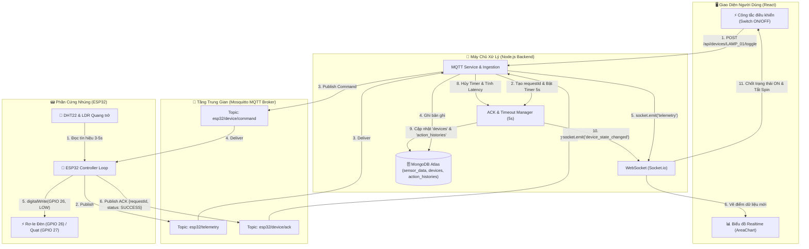
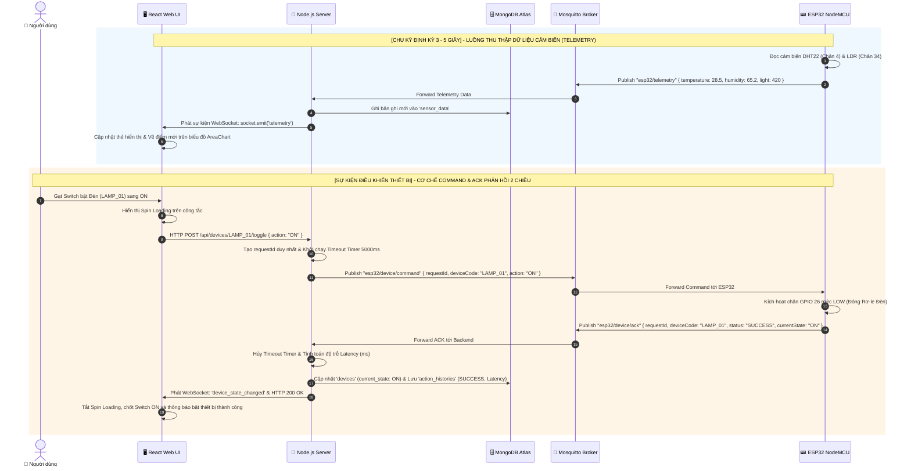

# 2.6. ĐẶC TẢ CHI TIẾT CÁC MQTT TOPICS & CƠ CHẾ TRUYỀN THÔNG HỆ THỐNG

> **Học viện Công nghệ Bưu chính Viễn thông (PTIT)**  
> **Học phần:** Lập trình thiết bị IoT & Hệ thống Nhúng  
> **Đồ án:** Hệ thống Giám sát Môi trường & Điều khiển Thiết bị Thông minh  
> **Giao thức cốt lõi:** MQTT (Message Queuing Telemetry Transport) qua Mosquitto Broker (Port 1883)  

---

## 1. KẾT QUẢ ĐỐI SOÁT & KIỂM TRA TƯƠNG THÍCH MÃ NGUỒN

Sau khi kiểm tra đối soát với toàn bộ mã nguồn thực tế của dự án:
- **Backend Service:** [`backend/src/config/mqtt.js`](file:///d:/Giaotrinh/PTIT/07_Ky_1_Nam_4/Iot/backend/src/config/mqtt.js), [`backend/src/services/mqtt.service.js`](file:///d:/Giaotrinh/PTIT/07_Ky_1_Nam_4/Iot/backend/src/services/mqtt.service.js), [`backend/src/services/ack.service.js`](file:///d:/Giaotrinh/PTIT/07_Ky_1_Nam_4/Iot/backend/src/services/ack.service.js)
- **Firmware ESP32:** [`hardware/firmware/iot_ptit_firmware/config.h`](file:///d:/Giaotrinh/PTIT/07_Ky_1_Nam_4/Iot/hardware/firmware/iot_ptit_firmware/config.h), [`hardware/firmware/iot_ptit_firmware/iot_ptit_firmware.ino`](file:///d:/Giaotrinh/PTIT/07_Ky_1_Nam_4/Iot/hardware/firmware/iot_ptit_firmware/iot_ptit_firmware.ino)

👉 **Kết luận:** Bảng thiết kế các MQTT Topics hoàn toàn **chính xác 100%**, phản ánh đúng cấu trúc phân tầng, chiều truyền dữ liệu, định dạng JSON payload và cơ chế xác thực hai chiều (Two-way ACK) đang vận hành trong hệ thống.

---

## 2. BẢNG ĐẶC TẢ CHI TIẾT CÁC MQTT TOPICS HỆ THỐNG

| STT | Topic Thiết Kế Chuẩn | Topic Triển Khai Thực Tế | Bên Gửi (Publisher) | Bên Nhận (Subscriber) | QoS | Retain | Tần Suất / Điều Kiện Kích Hoạt | Mục Đích & Vai Trò Nghiệp Vụ |
| :---: | :--- | :--- | :---: | :---: | :---: | :---: | :--- | :--- |
| **1** | `device/{deviceId}/telemetry` | `esp32/telemetry` | **ESP32** (Phần cứng) | **Backend** (Node.js) | 0 / 1 | `false` | Định kỳ mỗi **3 - 5 giây** (`TELEMETRY_INTERVAL`) | **Truyền số liệu cảm biến:** Đẩy dữ liệu đo Nhiệt độ (°C), Độ ẩm (%), Cường độ sáng (Lux) về Backend để lưu MongoDB (`sensor_data`) và phát realtime lên UI qua Socket.io. |
| **2** | `device/{deviceId}/command` | `esp32/device/command` | **Backend** (Node.js) | **ESP32** (Phần cứng) | 1 | `false` | Bất đồng bộ khi người dùng click công tắc trên Web UI | **Hạ lệnh điều khiển thiết bị:** Gửi lệnh Bật (`ON`) hoặc Tắt (`OFF`) Relay chân GPIO kèm mã giao dịch `requestId` duy nhất; khởi động bộ đếm Timeout 5000ms. |
| **3** | `device/{deviceId}/ack` | `esp32/device/ack` | **ESP32** (Phần cứng) | **Backend** (Node.js) | 1 | `false` | Tức thời ngay sau khi ESP32 kích hoạt chân Relay | **Phản hồi xác nhận thực thi (ACK):** Báo cáo trạng thái vật lý thực tế, hủy bộ đếm Timeout 5s, tính toán độ trễ mạng `latency_ms`, lưu vào `action_histories` và chốt trạng thái Switch trên UI. |
| **4** | `device/{deviceId}/status` | `esp32/status` | **ESP32 / Broker LWT** | **Backend** (Node.js) | 1 | `true` | Khi ESP32 kết nối / mất kết nối (LWT) | **Giám sát trạng thái sống (Heartbeat):** Gửi `ONLINE` khi kết nối thành công và tự động phát `OFFLINE` qua cơ chế Last Will and Testament nếu mất nguồn đột ngột. |

---

## 3. CHI TIẾT CÁCH THỨC GIAO TIẾP VÀ CẤU TRÚC GÓI TIN (PAYLOAD SPECIFICATION)



---

### 3.1. Kênh Telemetry (`esp32/telemetry` hoặc `device/{deviceId}/telemetry`)

* **Ý nghĩa:** Kênh truyền một chiều định kỳ từ cảm biến vật lý về máy chủ trung tâm.
* **Quy trình hoạt động:**
  1. Hàm `loop()` trên ESP32 kiểm tra `millis() - lastTelemetryTime >= 3000`.
  2. Đọc nhiệt độ (°C) và độ ẩm (%) từ cảm biến kỹ thuật số **DHT22** (Chân GPIO 4).
  3. Đọc giá trị tương tự (ADC 12-bit) từ **Quang trở LDR** (Chân GPIO 34) và ánh xạ sang dải 0 - 1000 Lux.
  4. Đóng gói JSON và Publish lên Broker. Backend nhận được sẽ lưu CSDL và phát tiếp tới React UI qua Socket.io `telemetry`.
* **Cấu trúc JSON Payload:**
  ```json
  {
    "deviceId": "ESP32_IOT_PTIT_NODE_01",
    "temperature": 28.5,
    "humidity": 65.2,
    "light": 420,
    "timestamp": 124560
  }
  ```

---

### 3.2. Kênh Command (`esp32/device/command` hoặc `device/{deviceId}/command`)

* **Ý nghĩa:** Kênh điều khiển mệnh lệnh từ máy chủ xuống vi điều khiển để thay đổi trạng thái đóng/ngắt thiết bị điện áp cao qua Rơ-le.
* **Quy trình hoạt động:**
  1. Người dùng thao tác gạt Switch trên Web Dashboard. Giao diện chuyển sang trạng thái chờ (Spin Loading).
  2. Gửi request `POST /api/devices/:deviceCode/toggle` kèm body `{ "action": "ON" }`.
  3. Backend tạo `requestId` duy nhất, khởi động bộ đếm Timeout 5s trong `ack.service.js`, sau đó Publish JSON xuống topic với **QoS 1**.
  4. ESP32 nhận gói tin trong hàm `onMqttCallback()`, giải mã JSON và kích hoạt chân GPIO tương ứng:
     * `LAMP_01` $\rightarrow$ Chân GPIO 26 (Relay kích mức thấp Active LOW).
     * `FAN_01` $\rightarrow$ Chân GPIO 27 (Module mở rộng dự phòng).
* **Cấu trúc JSON Payload:**
  ```json
  {
    "requestId": "REQ_1724138100000_ab12c",
    "deviceCode": "LAMP_01",
    "action": "ON",
    "timestamp": "2026-08-20T07:15:00.000Z"
  }
  ```

---

### 3.3. Kênh ACK (`esp32/device/ack` hoặc `device/{deviceId}/ack`)

* **Ý nghĩa:** Kênh phản hồi xác nhận hai chiều (Two-way Handshake) từ phần cứng ngược về máy chủ.
* **Quy trình hoạt động:**
  1. Ngay sau khi thực hiện xong lệnh `digitalWrite(pin, pinVal)`, ESP32 lập tức tạo gói tin ACK chứa đúng `requestId` đã nhận và xuất bản lên topic ACK.
  2. Backend nhận được gói tin ACK:
     * Đối chiếu `requestId` trong bảng chờ `pendingCommands`.
     * Hủy bỏ bộ hẹn giờ Timeout `clearTimeout(timer)`.
     * Tính toán độ trễ toàn trình: $\text{latency\_ms} = \text{Thời gian nhận ACK} - \text{Thời gian gửi Command}$.
     * Cập nhật trạng thái `current_state` của thiết bị trong collection `devices`.
     * Ghi nhật ký chi tiết vào collection `action_histories` với trạng thái `SUCCESS` và trường `latency_ms`.
     * Phát sự kiện WebSocket `device_state_changed` để giao diện tắt biểu tượng quay (Spin Loading) và chốt vị trí Switch.
* **Xử lý Ngoại lệ (Timeout 5000ms):**
  * Nếu sau 5000ms Backend không nhận được gói tin ACK (do ESP32 mất nguồn, rớt mạng hoặc đứt kết nối):
  * Bộ hẹn giờ kích hoạt: Hủy lệnh chờ, ghi nhật ký vào `action_histories` với trạng thái `TIMEOUT`.
  * Phản hồi mã lỗi HTTP 500 về Frontend.
  * Frontend tự động gạt Switch trở lại trạng thái cũ và hiện cảnh báo: *"Thiết bị không phản hồi, vui lòng kiểm tra nguồn phần cứng!"*
* **Cấu trúc JSON Payload:**
  ```json
  {
    "requestId": "REQ_1724138100000_ab12c",
    "deviceCode": "LAMP_01",
    "status": "SUCCESS",
    "currentState": "ON",
    "timestamp": 124688
  }
  ```

---

## 4. SƠ ĐỒ TUẦN TỰ TOÀN TRÌNH (FULL SEQUENCE DIAGRAM)



---

## 5. TỔNG KẾT CÁC ĐIỂM SÁNG KỸ THUẬT CHO BÁO CÁO

1. **Khép kín vòng điều khiển (Closed-loop Control):** Không bao giờ giả định trạng thái thiết bị thành công khi chưa nhận được xác nhận từ chân vật lý.
2. **Khả năng chống nghẽn và độc lập:** Việc phân tách thành 3 luồng Topic (`telemetry`, `command`, `ack`) giúp các luồng hoạt động song song, không làm ảnh hưởng đến độ trễ khi lượng bản tin cảm biến gửi về dày đặc.
3. **Đo đạc chính xác thời gian trễ thực tế:** Đưa vào chỉ số độ trễ mạng thực tế $T_{\text{latency}}$ vào nhật ký giúp hệ thống minh bạch hóa chất lượng đường truyền mạng trong phòng lab.
