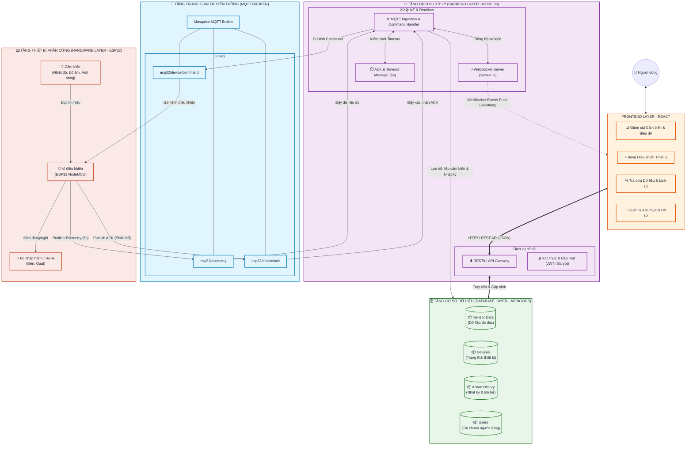
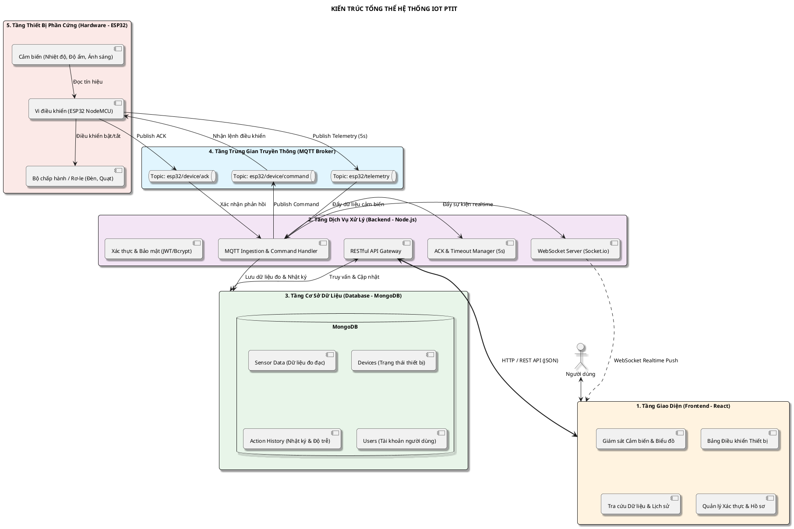

# KIẾN TRÚC TỔNG THỂ HỆ THỐNG IOT (SYSTEM ARCHITECTURE DIAGRAM)

> **Hệ thống:** Giám sát Môi trường & Điều khiển Thiết bị Thông minh  
> **Kiến trúc phân tầng:** 5 khối chức năng chính (Frontend $\leftrightarrow$ Backend $\leftrightarrow$ Database $\leftrightarrow$ MQTT Broker $\leftrightarrow$ Hardware)

---

## 1. Biểu Đồ Kiến Trúc Hệ Thống (Mermaid Diagram)

---

## 2. Biểu Đồ Kiến Trúc Hệ Thống (PlantUML Component Diagram)

---

## 3. Bảng Tóm Tắt Chức Năng & Giao Tiếp Giữa Các Tầng

| Tầng Kiến Trúc | Thành Phần Chức Năng Chính | Giao Thức / Cơ Chế Giao Tiếp | Luồng Dữ Liệu Tương Tác |
| :--- | :--- | :--- | :--- |
| **1. Frontend Layer** | Giám sát Realtime, Bảng điều khiển, Tra cứu lịch sử, Xác thực tài khoản | HTTP / REST API & WebSocket | - Gửi yêu cầu truy vấn / điều khiển qua REST API. - Nhận dữ liệu cảm biến & trạng thái thiết bị tức thời qua WebSocket. |
| **2. Backend Layer** | REST API Gateway, WebSocket Server, MQTT Handler, ACK & Timeout Manager, Auth | HTTP, WebSocket, MQTT, TCP/IP | - Xử lý nghiệp vụ, xác thực JWT, phân quyền. - Thu thập gói tin Telemetry, gửi lệnh điều khiển và quản lý Timeout 5s. |
| **3. Database Layer** | Collections: `sensor_data`, `devices`, `action_histories`, `users` | MongoDB WiredTiger Engine / TCP | - Lưu trữ bền vững dữ liệu đo đạc, nhật ký thao tác và tài khoản. |
| **4. MQTT Broker** | Mosquitto Broker (Topics: `telemetry`, `command`, `ack`) | MQTT Protocol (Port 1883 / QoS 0 & QoS 1) | - Trung gian phân phối thông điệp bất đồng bộ giữa Phần cứng và Backend. |
| **5. Hardware Layer** | Cảm biến môi trường, Vi điều khiển ESP32, Bộ chấp hành Rơ-le | GPIO, ADC, WiFi 802.11 b/g/n | - Đọc định kỳ cảm biến (5s), đóng ngắt rơ-le thiết bị và phát bản tin ACK. |
