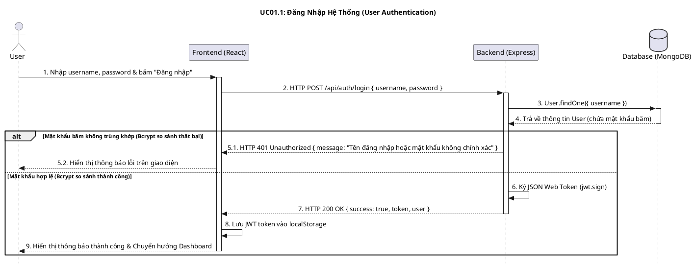
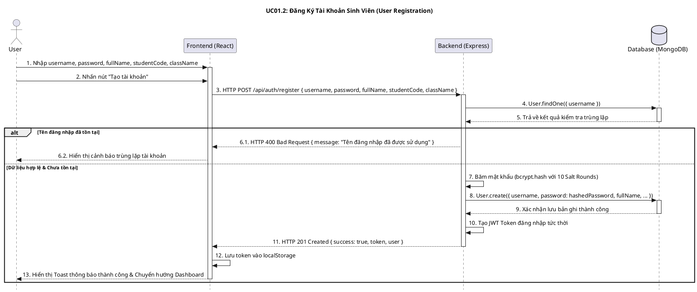
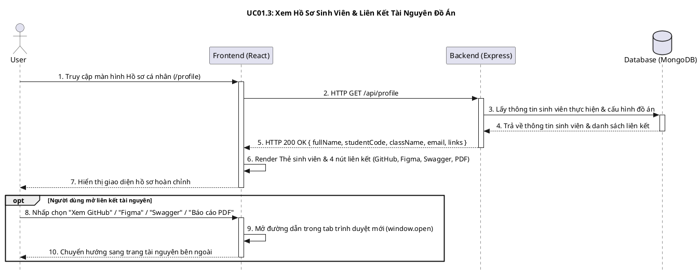
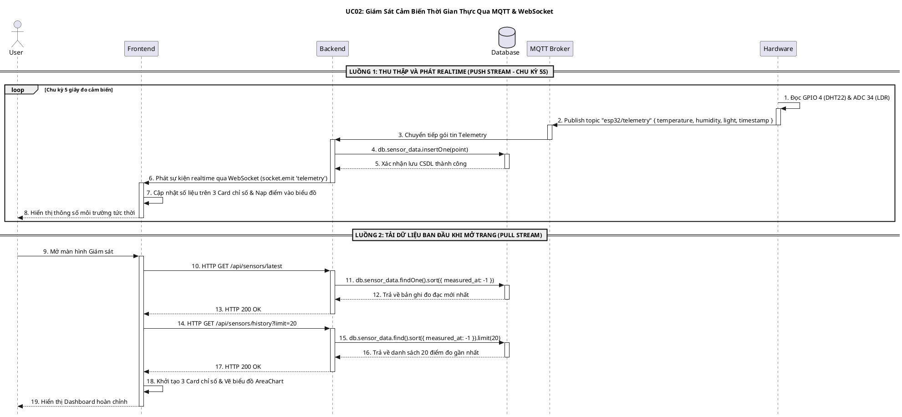
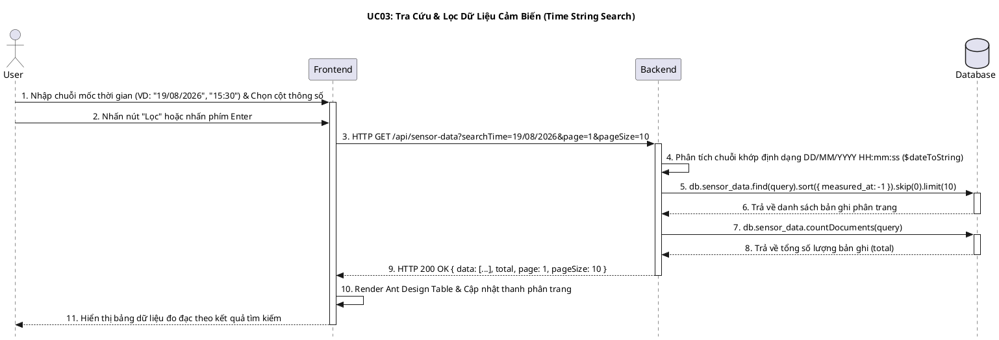
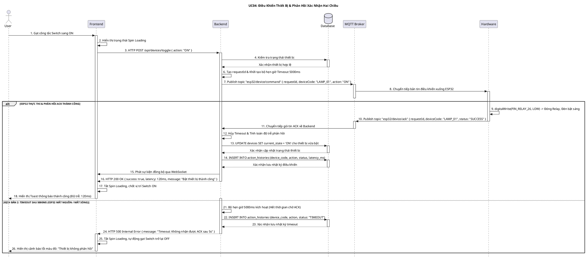
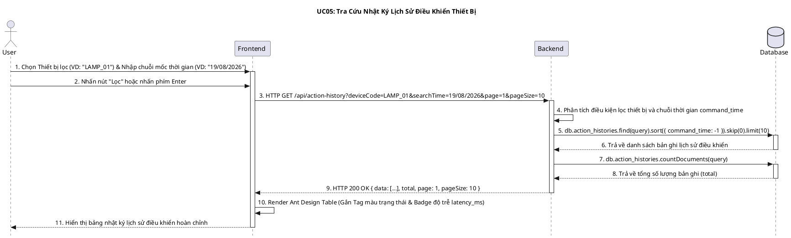

# TỔNG HỢP MÃ NGUỒN PLANTUML SEQUENCE DIAGRAM (USE CASE 01 - 05)

> **Dự án:** Hệ thống Giám sát Môi trường & Điều khiển Thiết bị IoT PTIT  
> **Định dạng:** PlantUML Sequence Diagram (`@startuml` ... `@enduml`)  
> **Cấu hình style:** `skinparam style strictuml`, `skinparam sequenceMessageAlign center`  

---

## 1. UC01.1: Đăng Nhập Hệ Thống (Login)

---

## 2. UC01.2: Đăng Ký Tài Khoản Sinh Viên (Register)

---

## 3. UC01.3: Xem Hồ Sơ Sinh Viên & Tài Nguyên Đồ Án (Profile)

---

## 4. UC02: Giám Sát Cảm Biến Thời Gian Thực (Realtime Telemetry)

---

## 5. UC03: Tra Cứu & Lọc Dữ Liệu Cảm Biến (Sensor Data Query)

---

## 6. UC04: Điều Khiển Thiết Bị Qua MQTT & Phản Hồi ACK (Device Control)

---

## 7. UC05: Tra Cứu Nhật Ký Lịch Sử Điều Khiển (Action History Query)

