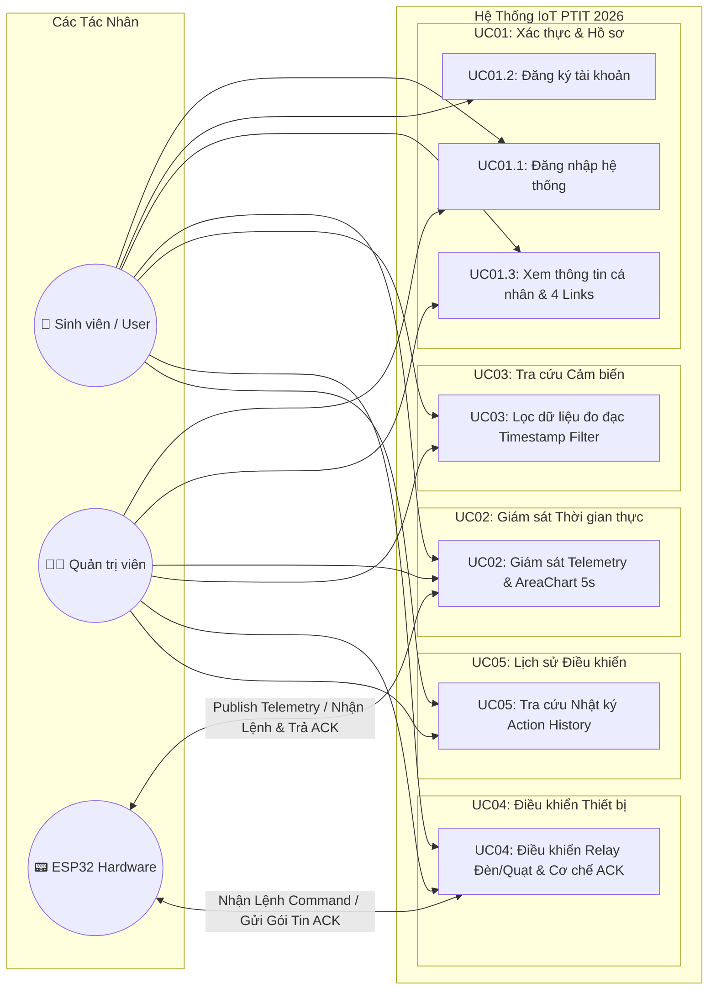

# BÁO CÁO THIẾT KẾ CHI TIẾT CÁC USE CASE HỆ THỐNG IOT PTIT 2026

> **Học viện Công nghệ Bưu chính Viễn thông (PTIT)**  
> **Đồ án môn học:** Lập trình thiết bị IoT & Hệ thống Nhúng  
> **Hệ thống:** Hệ thống Giám sát Môi trường & Điều khiển Thiết bị Thông minh  
> **Kiến trúc:** React (Vite/Ant Design) $\leftrightarrow$ Node.js/Express $\leftrightarrow$ MQTT Broker (Mosquitto) $\leftrightarrow$ ESP32 Node Hardware / MongoDB Atlas

---

## 📑 Danh Mục Use Case Hệ Thống

Hệ thống được thiết kế hoàn chỉnh theo 5 nhóm Use Case chính tương ứng với 5 phân hệ màn hình của ứng dụng:

| Mã UC | Tên Use Case | Tác Nhân Chính | Mô Tả Tóm Tắt | Tài Liệu Chi Tiết |
| :--- | :--- | :--- | :--- | :--- |
| **UC01** | Quản lý Xác thực & Hồ sơ Cá nhân | Người dùng / Sinh viên, Admin | Đăng nhập hệ thống, đăng ký tài khoản sinh viên, xem thông tin cá nhân và 4 liên kết đồ án (GitHub, Figma, Swagger, Báo cáo PDF). | [UC01 Tổng hợp & Chi tiết](./UC01_Authentication_Profile/SUMMARY_UC01.md) |
| **UC02** | Giám sát Cảm biến Thời gian thực | Người dùng, ESP32 Sensor Node | Hiển thị tức thời 3 chỉ số (Nhiệt độ, Độ ẩm, Ánh sáng) và biểu đồ AreaChart cập nhật chu kỳ 5 giây qua Socket.io & MQTT. | [UC02 Chi tiết](./UC02_Realtime_Telemetry/UC02_Giam_Sat_Cam_Bien_Realtime.md) |
| **UC03** | Tra cứu & Lọc Dữ liệu Cảm biến | Người dùng / Quản trị viên | Tra cứu lịch sử đo đạc cảm biến với ô tìm kiếm chuỗi thời gian (Time String Search khớp format `DD/MM/YYYY HH:mm:ss`), chọn thông số và phân trang. | [UC03 Chi tiết](./UC03_Sensor_Data_Query/UC03_Tra_Cuu_Loc_Du_Lieu_Cam_Bien.md) |
| **UC04** | Điều khiển Thiết bị & Phản hồi ACK | Người dùng, ESP32 Actuator Node | Gửi lệnh bật/tắt Relay Đèn/Quạt, xử lý cơ chế phản hồi xác nhận 2 chiều (MQTT ACK) và kiểm soát Timeout 5000ms. | [UC04 Chi tiết](./UC04_Device_Control/UC04_Dieu_Khien_Thiet_Bi_ACK.md) |
| **UC05** | Tra cứu Nhật ký Lịch sử Điều khiển | Người dùng / Quản trị viên | Tra cứu toàn bộ lịch sử gửi lệnh bật/tắt thiết bị, ghi nhận thời gian gửi, thời gian nhận phản hồi, độ trễ `latency_ms` và trạng thái `SUCCESS/TIMEOUT/FAILED`. | [UC05 Chi tiết](./UC05_Action_History/UC05_Tra_Cuu_Lich_Su_Dieu_Khien.md) |

---

## 👥 Ma Trận Phân Quyền & Tác Nhân (Actor Matrix)

Hệ thống có 3 tác nhân chính tham gia tương tác:
1. **Sinh viên / Người dùng (User / Student):** Người dùng có tài khoản, thực hiện giám sát, tra cứu dữ liệu và điều khiển thiết bị phòng lab.
2. **Quản trị viên (Admin):** Toàn quyền cấu hình hệ thống, quản lý tài khoản và xem toàn bộ nhật ký kiểm thử.
3. **Phần cứng ESP32 (Hardware Node):** Thiết bị vi điều khiển đọc cảm biến DHT22, quang trở LDR và kích đóng ngắt Relay 2 kênh.

| Use Case | Sinh Viên (Student) | Quản Trị Viên (Admin) | Phần Cứng ESP32 |
| :--- | :---: | :---: | :---: |
| **UC01.1: Đăng nhập hệ thống** | ✔ | ✔ | - |
| **UC01.2: Đăng ký tài khoản sinh viên** | ✔ | ✔ | - |
| **UC01.3: Xem thông tin hồ sơ & liên kết** | ✔ | ✔ | - |
| **UC02: Giám sát cảm biến Realtime & Biểu đồ** | ✔ | ✔ | ✔ (Publish Telemetry) |
| **UC03: Tra cứu & Lọc dữ liệu cảm biến** | ✔ | ✔ | - |
| **UC04: Điều khiển Relay & Xử lý ACK** | ✔ | ✔ | ✔ (Nhận Lệnh & Phản hồi ACK) |
| **UC05: Tra cứu lịch sử điều khiển thiết bị** | ✔ | ✔ | - |

---

## 🗺️ Sơ Đồ Tổng Thể Use Case (Use Case Diagram)

---

## 📂 Cấu Trúc Tài Liệu Chi Tiết

Mỗi tài liệu con trong các thư mục tương ứng cung cấp đầy đủ 6 phần bắt buộc theo quy chuẩn:
1. **Thông tin chung:** Tên UC, Mã UC, Actor, Mục đích.
2. **Điều kiện:** Tiền điều kiện (Preconditions), Hậu điều kiện (Postconditions).
3. **Mô tả luồng nghiệp vụ:** Luồng chính (Main Flow), Các luồng ngoại lệ/thay thế (Alternative & Exception Flows).
4. **Sơ đồ tuần tự (Sequence Diagram):** Biểu diễn chi tiết bằng mã Mermaid từ Giao diện $\rightarrow$ Router $\rightarrow$ Controller $\rightarrow$ Service/MQTT $\rightarrow$ Database/Hardware $\rightarrow$ Phản hồi UI.
5. **Mô tả tương tác Cơ sở dữ liệu:** Chi tiết bảng (Collection), Schema, các thao tác CRUD và Indexes.
6. **Bảng mô tả API chuẩn RESTful:** Endpoint, HTTP Method, Yêu cầu xác thực, Request Header/Body/Query, Response Status Codes (200, 201, 400, 401, 404, 500) và Schema Response JSON.
