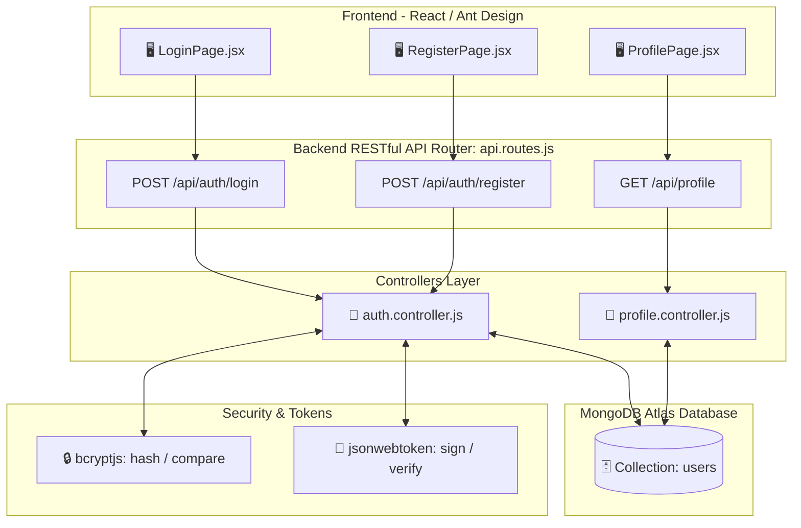

# TỔNG HỢP ĐẶC TẢ TƯƠNG TÁC DỮ LIỆU & API - PHÂN HỆ UC01 (AUTHENTICATION & PROFILE)

> **Phân hệ:** Quản lý Xác thực & Hồ sơ Cá nhân (Authentication & Profile Management)  
> **Các Use Case thành phần:**
> 1. [UC01.1: Đăng nhập hệ thống (Login)](./UC01_1_Dang_Nhap.md)
> 2. [UC01.2: Đăng ký tài khoản sinh viên (Register)](./UC01_2_Dang_Ky.md)
> 3. [UC01.3: Xem thông tin hồ sơ sinh viên & liên kết tài nguyên đồ án (Profile)](./UC01_3_Xem_Ho_So.md)

---

## 1. TỔNG QUAN PHÂN HỆ VÀ QUAN HỆ CÁC USE CASE

Phân hệ **UC01** chịu trách nhiệm toàn bộ về quản lý danh tính người dùng, cấp phát phiên làm việc an toàn bằng **JSON Web Token (JWT)**, mã hóa mật khẩu chuẩn công nghiệp (**Bcrypt Hash 10 Salt Rounds**), và cung cấp thông tin học thuật của sinh viên thực hiện đồ án phục vụ công tác chấm điểm và đánh giá.



---

## 2. TỔNG HỢP MÔ TẢ TƯƠNG TÁC CƠ SỞ DỮ LIỆU (DATABASE INTERACTIONS)

### 2.1. Ma Trận Thao Tác CRUD Trên Database Của 3 Use Case Con

| Mã Use Case | Tên Chức Năng | Tên Bảng (Collection) | Thao Tác CRUD | Phương Thức Mongoose | Mô Tả Nghiệp Vụ Tương Tác |
| :--- | :--- | :--- | :---: | :--- | :--- |
| **UC01.1** | Đăng nhập hệ thống | `users` | **READ** | `User.findOne({ username })` | Tìm kiếm tài khoản theo `username` để lấy chuỗi băm mật khẩu `password` phục vụ đối soát `bcrypt.compare()`. |
| **UC01.2** | Đăng ký tài khoản | `users` | **READ** | `User.findOne({ username })` | Kiểm tra xem `username` đã tồn tại trong CSDL chưa nhằm ngăn chặn việc tạo tài khoản trùng lặp. |
| **UC01.2** | Đăng ký tài khoản | `users` | **CREATE** | `User.create({ ... })` | Tạo mới bản ghi tài khoản sinh viên với mật khẩu đã được băm an toàn (`bcrypt.hash(password, 10)`). |
| **UC01.3** | Xem hồ sơ cá nhân | `users` | **READ** | `User.findById(userId)` / Config | Truy xuất thông tin sinh viên phục vụ hiển thị trên thẻ sinh viên và tải danh sách liên kết đồ án. |

---

### 2.2. Chi Tiết Cấu Trúc Schema Bảng `users` (Data Dictionary)

Collection `users` được định nghĩa trong Mongoose Model tại `backend/src/models/User.model.js` và `database/schemas/User.schema.js`:

```javascript
import mongoose from 'mongoose';

const UserSchema = new mongoose.Schema(
  {
    username: {
      type: String,
      required: [true, 'Tên đăng nhập là bắt buộc'],
      unique: true,
      trim: true,
      minlength: [3, 'Tên đăng nhập tối thiểu 3 ký tự'],
    },
    password: {
      type: String,
      required: [true, 'Mật khẩu là bắt buộc'],
      minlength: [6, 'Mật khẩu băm tối thiểu 6 ký tự'],
    },
    fullName: {
      type: String,
      required: [true, 'Họ và tên là bắt buộc'],
      trim: true,
    },
    studentCode: {
      type: String,
      required: [true, 'Mã số sinh viên là bắt buộc'],
      trim: true,
    },
    className: {
      type: String,
      required: [true, 'Lớp sinh hoạt là bắt buộc'],
      trim: true,
    },
    role: {
      type: String,
      enum: ['STUDENT', 'ADMIN', 'LECTURER'],
      default: 'STUDENT',
    },
    createdAt: {
      type: Date,
      default: Date.now,
    },
  },
  {
    timestamps: true,
    collection: 'users',
  }
);

// Index tối ưu tìm kiếm theo tên đăng nhập duy nhất
UserSchema.index({ username: 1 }, { unique: true });

export const User = mongoose.model('User', UserSchema);
```

#### Bảng Từ Điển Dữ Liệu (Data Dictionary Table):

| Tên Trường (Field) | Kiểu Dữ Liệu | Bắt Buộc | Duy Nhất | Mặc Định | Mô Tả & Ví Dụ |
| :--- | :--- | :---: | :---: | :--- | :--- |
| `_id` | `ObjectId` | Có | Có | Tự sinh (MongoDB) | Khóa chính của bản ghi người dùng |
| `username` | `String` | Có | Có | Không | Tên tài khoản đăng nhập (VD: `admin`, `van22052k5`) |
| `password` | `String` | Có | Không | Không | Chuỗi băm mật khẩu Bcrypt Hash (VD: `$2a$10$e7mK8...`) |
| `fullName` | `String` | Có | Không | Không | Họ và tên sinh viên (VD: `Lương Hải Vân`) |
| `studentCode` | `String` | Có | Không | Không | Mã số sinh viên (VD: `B23DCAT332`) |
| `className` | `String` | Có | Không | Không | Lớp sinh viên học phần (VD: `D23CQAT02-B`) |
| `role` | `String` | Không | Không | `'STUDENT'` | Phân quyền truy cập: `STUDENT`, `ADMIN` |
| `createdAt` | `Date` | Không | Không | `Date.now` | Thời điểm tạo tài khoản (ISO Date UTC) |
| `updatedAt` | `Date` | Không | Không | `Date.now` | Thời điểm cập nhật tài khoản gần nhất |

---

## 3. TỔNG HỢP BẢNG ĐẶC TẢ CÁC API CỦA PHÂN HỆ UC01

### 3.1. Bảng Ma Trận Danh Mục API

| STT | Use Case Con | Endpoint URL | HTTP Method | Yêu Cầu Xác Thực (Auth) | Mô Tả Tóm Tắt |
| :---: | :--- | :--- | :---: | :---: | :--- |
| 1 | **UC01.1** | `/api/auth/login` | `POST` | Public (Không) | Xác thực tài khoản & mật khẩu, trả về JWT Token và thông tin User. |
| 2 | **UC01.2** | `/api/auth/register` | `POST` | Public (Không) | Đăng ký tài khoản sinh viên mới, mã hóa mật khẩu, tạo bản ghi DB và cấp JWT. |
| 3 | **UC01.3** | `/api/profile` | `GET` | Public / Bearer Token | Lấy thông tin sinh viên thực hiện và danh sách 4 liên kết đồ án (GitHub, Figma, Swagger, PDF). |

---

### 3.2. Đặc Tả Chi Tiết Từng API

---

#### 📌 API 1: Đăng Nhập Hệ Thống (`POST /api/auth/login`)

| Thuộc Tính | Chi Tiết |
| :--- | :--- |
| **Endpoint** | `/api/auth/login` |
| **HTTP Method** | `POST` |
| **Header** | `Content-Type: application/json` |
| **Xác Thực (Auth)** | Không (Public) |
| **Request Body** | ```json<br>{<br>  "username": "admin",<br>  "password": "admin123"<br>}<br>``` |

##### Bảng Mã Lỗi & Trạng Thái HTTP (Status Codes):
| HTTP Status Code | Ý Nghĩa / Tình Huống | Cấu Trúc Response JSON Mẫu |
| :---: | :--- | :--- |
| **`200 OK`** | Đăng nhập thành công | ```json<br>{<br>  "success": true,<br>  "token": "eyJhbGciOiJIUzI1NiIsInR5cCI6IkpXVCJ9...",<br>  "user": {<br>    "username": "admin",<br>    "fullName": "Lương Hải Vân",<br>    "studentCode": "B23DCAT332",<br>    "className": "D23CQAT02-B",<br>    "role": "ADMIN"<br>  }<br>}<br>``` |
| **`400 Bad Request`** | Thiếu trường username hoặc password | ```json<br>{<br>  "message": "Vui lòng nhập đầy đủ tên đăng nhập và mật khẩu"<br>}<br>``` |
| **`401 Unauthorized`** | Sai tên đăng nhập hoặc mật khẩu | ```json<br>{<br>  "message": "Tên đăng nhập hoặc mật khẩu không chính xác"<br>}<br>``` |
| **`500 Internal Error`** | Lỗi máy chủ hoặc mất kết nối DB | ```json<br>{<br>  "message": "Lỗi máy chủ nội bộ: MongoNetworkError"<br>}<br>``` |

---

#### 📌 API 2: Đăng Ký Tài Khoản Sinh Viên (`POST /api/auth/register`)

| Thuộc Tính | Chi Tiết |
| :--- | :--- |
| **Endpoint** | `/api/auth/register` |
| **HTTP Method** | `POST` |
| **Header** | `Content-Type: application/json` |
| **Xác Thực (Auth)** | Không (Public) |
| **Request Body** | ```json<br>{<br>  "username": "van22052k5",<br>  "password": "securepassword123",<br>  "fullName": "Lương Hải Vân",<br>  "studentCode": "B23DCAT332",<br>  "className": "D23CQAT02-B"<br>}<br>``` |

##### Bảng Mã Lỗi & Trạng Thái HTTP (Status Codes):
| HTTP Status Code | Ý Nghĩa / Tình Huống | Cấu Trúc Response JSON Mẫu |
| :---: | :--- | :--- |
| **`201 Created`** | Đăng ký tài khoản thành công | ```json<br>{<br>  "success": true,<br>  "message": "Đăng ký tài khoản sinh viên thành công!",<br>  "token": "eyJhbGciOiJIUzI1NiIsInR5cCI6IkpXVCJ9...",<br>  "user": {<br>    "username": "van22052k5",<br>    "fullName": "Lương Hải Vân",<br>    "studentCode": "B23DCAT332",<br>    "className": "D23CQAT02-B",<br>    "role": "STUDENT"<br>  }<br>}<br>``` |
| **`400 Bad Request`** | Thiếu trường hoặc password < 6 ký tự | ```json<br>{<br>  "message": "Mật khẩu phải có độ dài tối thiểu 6 ký tự!"<br>}<br>``` |
| **`400 Bad Request`** | Trùng tên đăng nhập (`username`) | ```json<br>{<br>  "message": "Tên đăng nhập này đã được sử dụng. Vui lòng chọn tên khác!"<br>}<br>``` |
| **`500 Internal Error`** | Lỗi máy chủ hoặc lỗi ghi DB | ```json<br>{<br>  "message": "Lỗi lưu bản ghi người dùng vào cơ sở dữ liệu"<br>}<br>``` |

---

#### 📌 API 3: Lấy Thông Tin Hồ Sơ & Liên Kết Đồ Án (`GET /api/profile`)

| Thuộc Tính | Chi Tiết |
| :--- | :--- |
| **Endpoint** | `/api/profile` |
| **HTTP Method** | `GET` |
| **Header** | `Accept: application/json`, `Authorization: Bearer <token>` *(tùy chọn)* |
| **Xác Thực (Auth)** | Không bắt buộc (Hỗ trợ truy cập nhanh phục vụ chấm đồ án) |
| **Request Params** | Không có |

##### Bảng Mã Lỗi & Trạng Thái HTTP (Status Codes):
| HTTP Status Code | Ý Nghĩa / Tình Huống | Cấu Trúc Response JSON Mẫu |
| :---: | :--- | :--- |
| **`200 OK`** | Lấy thông tin hồ sơ thành công | ```json<br>{<br>  "fullName": "Lương Hải Vân",<br>  "studentCode": "B23DCAT332",<br>  "className": "D23CQAT02-B",<br>  "faculty": "Khoa An toàn Thông tin - PTIT",<br>  "email": "van22052k5@gmail.com",<br>  "projectName": "Hệ thống Giám sát Môi trường & Điều khiển Thiết bị IoT Smart PTIT",<br>  "links": {<br>    "github": "https://github.com/Van22052k5/Iot",<br>    "figma": "https://www.figma.com/design/sample-iot-ptit",<br>    "swagger": "http://localhost:5000/api-docs",<br>    "reportPdf": "https://ptit.edu.vn/reports/iot_report_B23DCAT332.pdf"<br>  }<br>}<br>``` |
| **`500 Internal Error`** | Lỗi xử lý trên server | ```json<br>{<br>  "message": "Không thể lấy thông tin hồ sơ tác giả"<br>}<br>``` |

---

## 4. CƠ CHẾ BẢO MẬT & QUẢN LÝ PHIÊN (SECURITY & JWT LIFECYCLE)

1. **Mã Hóa Mật Khẩu (Bcrypt Hashing):**
   - Khi đăng ký, mật khẩu dạng Plain Text được băm qua hàm `bcrypt.hash(password, 10)` sinh ra chuỗi mã băm 60 ký tự một chiều. Mật khẩu gốc không bao giờ được lưu trữ trong CSDL.
   - Khi đăng nhập, hệ thống sử dụng `bcrypt.compare(password, user.password)` để đối chiếu an toàn chống lại các kỹ thuật tấn công Timing Attack.

2. **Cấp Phát & Xác Thực JSON Web Token (JWT):**
   - Cấu trúc Payload Token: `{ id: user._id, username: user.username, role: user.role }`.
   - Thuật toán ký: `HMAC-SHA256 (HS256)` với khóa bí mật `JWT_SECRET`.
   - Thời hạn hiệu lực (TTL): `7d` (7 ngày).

3. **Lưu Trữ Phía Trình Duyệt (Client Storage):**
   - Frontend lưu `token` và `user` vào `localStorage`.
   - Mọi request cần quyền truy cập sẽ tự động gắn header `Authorization: Bearer <token>` thông qua Axios Interceptor tại `frontend/src/services/api.js`.
