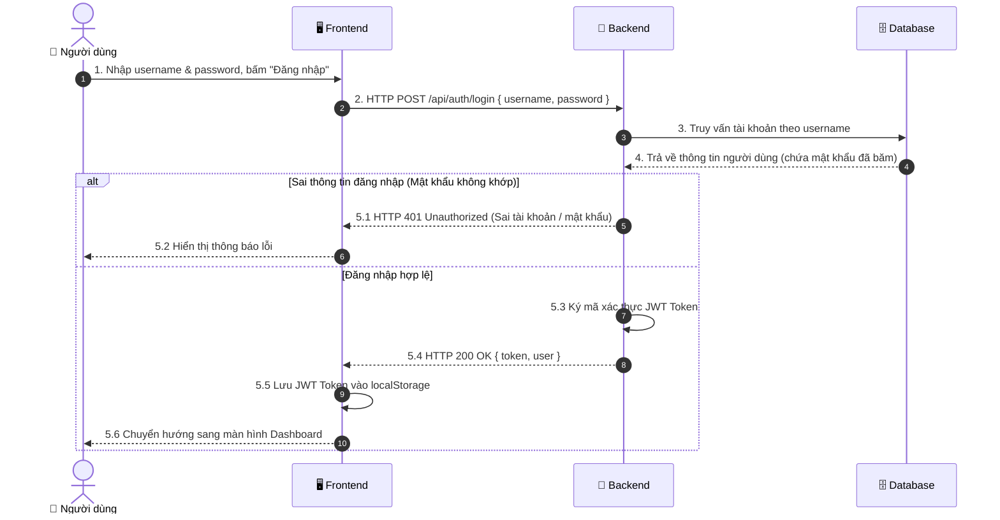

# ĐẶC TẢ CHI TIẾT USE CASE UC01.1: ĐĂNG NHẬP HỆ THỐNG (LOGIN)

---

## 1. THÔNG TIN CHUNG

| Thuộc tính | Nội dung |
| :--- | :--- |
| **Mã Use Case** | `UC01.1` |
| **Tên Use Case** | Đăng nhập hệ thống (User Authentication / Login) |
| **Phân hệ** | Quản lý Xác thực & Hồ sơ Cá nhân (Authentication & Profile) |
| **Tác nhân (Actors)** | Sinh viên (Student), Quản trị viên (Admin) |
| **Mục đích** | Xác thực danh tính người dùng bằng Tên đăng nhập (`username`) và Mật khẩu (`password`), cấp phát JSON Web Token (JWT) để người dùng truy cập các tính năng giám sát và điều khiển của hệ thống IoT. |

---

## 2. ĐIỀU KIỆN

### 2.1. Tiền điều kiện (Preconditions)
- Ứng dụng Frontend và máy chủ Backend đang hoạt động.
- Người dùng đã truy cập vào trang Đăng nhập (`/login` hoặc `LoginPage.jsx`).
- Tài khoản người dùng đã tồn tại trong cơ sở dữ liệu MongoDB (hoặc sử dụng tài khoản quản trị viên mặc định `admin` / `admin123`).

### 2.2. Hậu điều kiện (Postconditions)
- **Thành công:** Hệ thống lưu JWT Token và thông tin User vào `localStorage` của trình duyệt; chuyển hướng người dùng đến trang Giám sát trung tâm (`/dashboard`).
- **Thất bại:** Hệ thống giữ nguyên người dùng tại trang Đăng nhập và hiển thị thông báo lỗi tương ứng trên giao diện (Ant Design Message).

---

## 3. MÔ TẢ LUỒNG NGHIỆP VỤ (USE CASE FLOWS)

Hệ thống cung cấp cơ chế xác thực tài khoản an toàn qua JWT, kết hợp giữa **Luồng sự kiện chính (Đăng nhập thành công)** và **Các luồng xử lý ngoại lệ**:

### 3.1. Luồng sự kiện chính (Basic Flow: Đăng nhập thành công)

| STT | Thực hiện bởi | Hành động |
| :---: | :--- | :--- |
| 1 | Người dùng | Nhập Tên đăng nhập (`username`) và Mật khẩu (`password`) trên biểu mẫu đăng nhập. |
| 2 | Người dùng | Nhấn nút **"Đăng nhập"** hoặc ấn phím **Enter**. |
| 3 | Hệ thống (Frontend) | Kiểm tra nhanh định dạng dữ liệu phía Client và gửi yêu cầu `HTTP POST /api/auth/login` đến máy chủ. |
| 4 | Hệ thống (Backend) | Tiếp nhận yêu cầu, truy vấn Cơ sở dữ liệu để tìm tài khoản người dùng theo `username`. |
| 5 | Hệ thống (Backend) | So khớp mật khẩu đã băm (Bcrypt Hash). |
| 6 | Hệ thống (Backend) | Tạo mã xác thực JSON Web Token (JWT) có thời hạn hiệu lực và phản hồi kết quả HTTP 200 OK kèm Token và thông tin người dùng. |
| 7 | Hệ thống (Frontend) | Lưu JWT Token vào `localStorage`, hiển thị thông báo thành công và chuyển hướng người dùng sang màn hình Giám sát trung tâm (`/dashboard`). |

### 3.2. Luồng xử lý ngoại lệ (Exception Flows)

| STT | Mã ngoại lệ | Thực hiện bởi | Hành động |
| :---: | :---: | :--- | :--- |
| 1 | **E1** | Hệ thống (Backend / Frontend) | **Thiếu thông tin đăng nhập:** Máy chủ phản hồi mã lỗi HTTP 400 Bad Request; giao diện hiển thị thông báo yêu cầu nhập đầy đủ thông tin. |
| 2 | **E2** | Hệ thống (Backend / Frontend) | **Sai tên đăng nhập hoặc mật khẩu:** Không tìm thấy tài khoản hoặc mật khẩu không khớp, máy chủ trả về mã HTTP 401 Unauthorized; giao diện hiển thị cảnh báo tài khoản hoặc mật khẩu không đúng. |
| 3 | **E3** | Hệ thống (Backend / Frontend) | **Lỗi kết nối CSDL:** Máy chủ trả về mã HTTP 500; giao diện hiển thị thông báo lỗi hệ thống để người dùng thử lại sau. |

---

## 4. SƠ ĐỒ TUẦN TỰ (SEQUENCE DIAGRAM)




---

## 5. MÔ TẢ TƯƠNG TÁC CƠ SỞ DỮ LIỆU (DATABASE)

| Tên Bảng (Collection) | Thao Tác CRUD | Mô Tả & Điều Kiện Truy Vấn |
| :--- | :---: | :--- |
| **`users`** | `READ (findOne)` | Tìm kiếm thông tin tài khoản theo tên đăng nhập: `db.users.findOne({ username: req.body.username })` |

### Cấu trúc Schema Bảng `users`:
```javascript
{
  username: { type: String, required: true, unique: true }, // Tên đăng nhập
  password: { type: String, required: true },               // Mật khẩu đã băm (Bcrypt Hash)
  fullName: { type: String, required: true },               // Họ tên đầy đủ sinh viên
  studentCode: { type: String, required: true },           // Mã số sinh viên (VD: B23DCAT332)
  className: { type: String, required: true },             // Tên lớp sinh hoạt (VD: D23CQAT02-B)
  role: { type: String, default: 'STUDENT' },               // Phân quyền (STUDENT / ADMIN)
  createdAt: { type: Date, default: Date.now }              // Thời điểm tạo tài khoản
}
```

---

## 6. MÔ TẢ API (RESTFUL API SPECIFICATION)

### Bảng Đặc Tả API Đăng Nhập:

| Thành Phần | Chi Tiết |
| :--- | :--- |
| **Endpoint** | `/api/auth/login` |
| **HTTP Method** | `POST` |
| **Yêu Cầu Xác Thực (Auth)** | Không yêu cầu (Public Endpoint) |
| **Content-Type** | `application/json` |
| **Request Body** | `{ "username": "admin", "password": "password123" }` |

### Bảng Mã Trạng Thái HTTP & Cấu Trúc Trả Về:

| HTTP Status Code | Tình Huống | Cấu Trúc Response JSON Mẫu |
| :---: | :--- | :--- |
| **`200 OK`** | Đăng nhập thành công | ```json<br>{<br>  "success": true,<br>  "token": "eyJhbGciOiJIUzI1NiIsInR5cCI6IkpXVCJ9...",<br>  "user": {<br>    "username": "admin",<br>    "fullName": "Lương Hải Vân",<br>    "studentCode": "B23DCAT332",<br>    "className": "D23CQAT02-B",<br>    "role": "ADMIN"<br>  }<br>}<br>``` |
| **`400 Bad Request`** | Thiếu username hoặc password | ```json<br>{<br>  "message": "Vui lòng nhập đầy đủ tên đăng nhập và mật khẩu"<br>}<br>``` |
| **`401 Unauthorized`** | Sai username hoặc sai password | ```json<br>{<br>  "message": "Tên đăng nhập hoặc mật khẩu không chính xác"<br>}<br>``` |
| **`500 Internal Error`** | Lỗi server hoặc lỗi kết nối DB | ```json<br>{<br>  "message": "MongoServerError: connection timed out"<br>}<br>``` |
