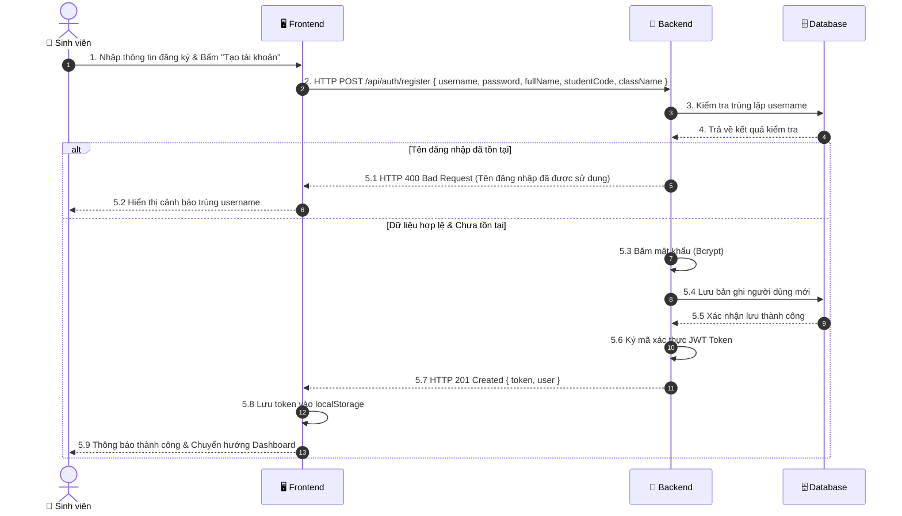

# ĐẶC TẢ CHI TIẾT USE CASE UC01.2: ĐĂNG KÝ TÀI KHOẢN (REGISTER)

---

## 1. THÔNG TIN CHUNG

| Thuộc tính | Nội dung |
| :--- | :--- |
| **Mã Use Case** | `UC01.2` |
| **Tên Use Case** | Đăng ký tài khoản sinh viên mới (User Registration) |
| **Phân hệ** | Quản lý Xác thực & Hồ sơ Cá nhân (Authentication & Profile) |
| **Tác nhân (Actors)** | Sinh viên mới (Guest / Student) |
| **Mục đích** | Cho phép sinh viên đăng ký tài khoản truy cập hệ thống IoT bằng cách cung cấp thông tin học thuật (Họ tên, Mã sinh viên, Lớp học) và thiết lập mật khẩu bảo mật (được băm bằng Bcrypt). |

---

## 2. ĐIỀU KIỆN

### 2.1. Tiền điều kiện (Preconditions)
- Ứng dụng Frontend và Backend đang hoạt động.
- Người dùng truy cập trang Đăng ký (`/register` hoặc `RegisterPage.jsx`).

### 2.2. Hậu điều kiện (Postconditions)
- **Thành công:** Bản ghi người dùng mới được lưu vào bảng `users` trong MongoDB với mật khẩu đã được băm an toàn; hệ thống tự động cấp phát token JWT và đăng nhập trực tiếp vào hệ thống.
- **Thất bại:** Bản ghi không được tạo; hệ thống hiển thị thông báo lỗi cụ thể (trùng tên đăng nhập, mật khẩu ngắn, thiếu trường...).

---

## 3. MÔ TẢ LUỒNG NGHIỆP VỤ (USE CASE FLOWS)

Hệ thống cho phép đăng ký tài khoản sinh viên mới, kết hợp giữa **Luồng sự kiện chính (Đăng ký thành công)** và **Các luồng xử lý ngoại lệ**:

### 3.1. Luồng sự kiện chính (Basic Flow: Đăng ký thành công)

| STT | Thực hiện bởi | Hành động |
| :---: | :--- | :--- |
| 1 | Người dùng | Nhập thông tin tài khoản: Tên đăng nhập, Mật khẩu, Họ tên, Mã sinh viên, Lớp học trên biểu mẫu đăng ký. |
| 2 | Người dùng | Nhấn nút **"Tạo tài khoản"**. |
| 3 | Hệ thống (Frontend) | Kiểm tra nhanh định dạng dữ liệu (mật khẩu $\ge 6$ ký tự, không để trống) và gửi `HTTP POST /api/auth/register` đến máy chủ. |
| 4 | Hệ thống (Backend) | Kiểm tra tính hợp lệ và kiểm tra trùng lặp `username` trong Cơ sở dữ liệu. |
| 5 | Hệ thống (Backend) | Thực hiện băm mật khẩu an toàn bằng thuật toán Bcrypt (10 vòng Salt). |
| 6 | Hệ thống (Backend) | Lưu bản ghi tài khoản mới vào CSDL với quyền mặc định `STUDENT`. |
| 7 | Hệ thống (Backend) | Tự động tạo mã xác thực JWT Token và phản hồi mã HTTP 201 Created kèm Token và thông tin tài khoản. |
| 8 | Hệ thống (Frontend) | Lưu Token vào `localStorage`, hiển thị thông báo đăng ký thành công và chuyển hướng người dùng sang màn hình Giám sát trung tâm (`/dashboard`). |

### 3.2. Luồng xử lý ngoại lệ (Exception Flows)

| STT | Mã ngoại lệ | Thực hiện bởi | Hành động |
| :---: | :---: | :--- | :--- |
| 1 | **E1** | Hệ thống (Frontend / Backend) | **Thiếu thông tin hoặc Mật khẩu quá ngắn (<6 ký tự):** Máy chủ trả về mã HTTP 400 Bad Request; giao diện hiển thị thông báo yêu cầu bổ sung thông tin hợp lệ. |
| 2 | **E2** | Hệ thống (Backend / Frontend) | **Trùng tên đăng nhập:** `username` đã tồn tại trong hệ thống, máy chủ trả về mã HTTP 400 Bad Request; giao diện hiển thị cảnh báo yêu cầu chọn tên đăng nhập khác. |
| 3 | **E3** | Hệ thống (Backend / Frontend) | **Lỗi cơ sở dữ liệu:** Máy chủ trả về mã HTTP 500; giao diện hiển thị thông báo lỗi hệ thống. |

---

## 4. SƠ ĐỒ TUẦN TỰ (SEQUENCE DIAGRAM)




---

## 5. MÔ TẢ TƯƠNG TÁC CƠ SỞ DỮ LIỆU (DATABASE)

| Tên Bảng (Collection) | Thao Tác CRUD | Mô Tả & Điều Kiện Truy Vấn |
| :--- | :---: | :--- |
| **`users`** | `READ (findOne)` | Kiểm tra trùng lặp: `db.users.findOne({ username: req.body.username })` |
| **`users`** | `CREATE (insertOne)` | Lưu bản ghi tài khoản mới kèm mật khẩu mã hóa: `db.users.insertOne({ username, password: hashedPassword, fullName, studentCode, className, role: 'STUDENT' })` |

---

## 6. MÔ TẢ API (RESTFUL API SPECIFICATION)

### Bảng Đặc Tả API Đăng Ký:

| Thành Phần | Chi Tiết |
| :--- | :--- |
| **Endpoint** | `/api/auth/register` |
| **HTTP Method** | `POST` |
| **Yêu Cầu Xác Thực (Auth)** | Không yêu cầu (Public Endpoint) |
| **Content-Type** | `application/json` |
| **Request Body Mẫu** | ```json<br>{<br>  "username": "haivan2026",<br>  "password": "mypassword123",<br>  "fullName": "Lương Hải Vân",<br>  "studentCode": "B23DCAT332",<br>  "className": "D23CQAT02-B"<br>}<br>``` |

### Bảng Mã Trạng Thái HTTP & Cấu Trúc Trả Về:

| HTTP Status Code | Tình Huống | Cấu Trúc Response JSON Mẫu |
| :---: | :--- | :--- |
| **`201 Created`** | Đăng ký tài khoản thành công | ```json<br>{<br>  "success": true,<br>  "message": "Đăng ký tài khoản sinh viên thành công!",<br>  "token": "eyJhbGciOiJIUzI1NiIsInR5cCI6IkpXVCJ9...",<br>  "user": {<br>    "username": "haivan2026",<br>    "fullName": "Lương Hải Vân",<br>    "studentCode": "B23DCAT332",<br>    "className": "D23CQAT02-B",<br>    "role": "STUDENT"<br>  }<br>}<br>``` |
| **`400 Bad Request`** | Thiếu trường hoặc mật khẩu < 6 ký tự hoặc trùng username | ```json<br>{<br>  "message": "Tên đăng nhập này đã được sử dụng. Vui lòng chọn tên khác!"<br>}<br>``` |
| **`500 Internal Error`** | Lỗi server hoặc lỗi kết nối DB | ```json<br>{<br>  "message": "Internal Server Error: E11000 duplicate key error collection"<br>}<br>``` |
