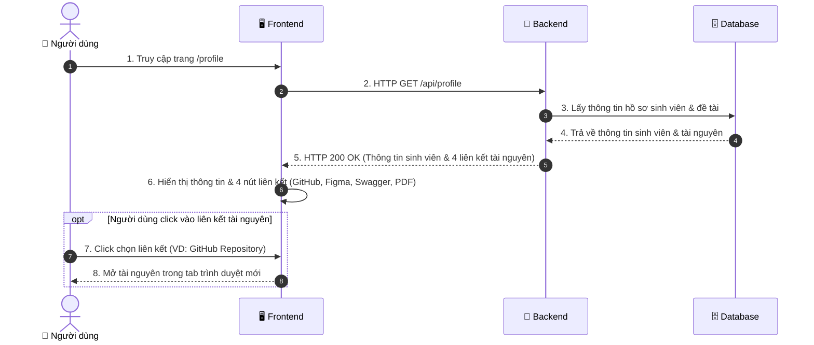

# ĐẶC TẢ CHI TIẾT USE CASE UC01.3: XEM HỒ SƠ CÁ NHÂN & LIÊN KẾT ĐỒ ÁN (PROFILE)

---

## 1. THÔNG TIN CHUNG

| Thuộc tính | Nội dung |
| :--- | :--- |
| **Mã Use Case** | `UC01.3` |
| **Tên Use Case** | Xem hồ sơ sinh viên & liên kết tài nguyên đồ án (View Student Profile & Resources) |
| **Phân hệ** | Quản lý Xác thực & Hồ sơ Cá nhân (Authentication & Profile) |
| **Tác nhân (Actors)** | Sinh viên (Student), Giảng viên chấm điểm (Lecturer / Evaluator) |
| **Mục đích** | Cung cấp màn hình hiển thị thông tin học thuật của sinh viên thực hiện đồ án (Họ tên, MSSV, Lớp, Email, Khoa), thông tin bài toán môn học IoT, và 4 nút liên kết trọng tâm phục vụ đánh giá: **GitHub Repository**, **Figma UI/UX Design**, **Swagger API Documentation**, và **Báo cáo Đồ án PDF**. |

---

## 2. ĐIỀU KIỆN

### 2.1. Tiền điều kiện (Preconditions)
- Người dùng đã đăng nhập vào hệ thống hoặc truy cập trang Hồ sơ (`/profile` tại `ProfilePage.jsx`).

### 2.2. Hậu điều kiện (Postconditions)
- Toàn bộ thông tin cá nhân của sinh viên, thông tin đề tài môn học và 4 liên kết tài nguyên bên ngoài được hiển thị trực quan dưới dạng thẻ Card với giao diện Tone Cam - Trắng chuyên nghiệp.

---

## 3. MÔ TẢ LUỒNG NGHIỆP VỤ (USE CASE FLOWS)

Hệ thống cung cấp màn hình hiển thị hồ sơ học thuật và các liên kết tài nguyên đồ án, kết hợp giữa **Luồng sự kiện chính (Xem hồ sơ & Mở tài nguyên)** và **Các luồng xử lý ngoại lệ**:

### 3.1. Luồng sự kiện chính (Basic Flow: Xem hồ sơ sinh viên)

| STT | Thực hiện bởi | Hành động |
| :---: | :--- | :--- |
| 1 | Người dùng | Điều hướng đến mục **"Hồ sơ cá nhân"** (`/profile`). |
| 2 | Hệ thống (Frontend) | Gửi yêu cầu `HTTP GET /api/profile` đến máy chủ Backend để lấy thông tin sinh viên và các liên kết tài nguyên. |
| 3 | Hệ thống (Backend) | Truy xuất thông tin cấu hình tác giả và đề tài từ CSDL hoặc Profile config. |
| 4 | Hệ thống (Backend) | Phản hồi mã HTTP 200 OK kèm thông tin sinh viên và 4 đường dẫn tài nguyên (GitHub, Figma, Swagger, Báo cáo PDF). |
| 5 | Hệ thống (Frontend) | Hiển thị thẻ thông tin cá nhân và 4 thẻ liên kết nhanh. |
| 6 | Người dùng | Nhấp vào một trong các liên kết tài nguyên đồ án để mở xem trong tab mới của trình duyệt. |

### 3.2. Luồng xử lý ngoại lệ (Exception Flows)

| STT | Mã ngoại lệ | Thực hiện bởi | Hành động |
| :---: | :---: | :--- | :--- |
| 1 | **E1** | Hệ thống (Frontend) | **Mất kết nối máy chủ Backend:** Giao diện tự động kích hoạt chế độ dữ liệu dự phòng (Fallback Data) đã cấu hình sẵn thông tin sinh viên Lương Hải Vân - B23DCAT332 để đảm bảo màn hình luôn hiển thị đầy đủ, không bị lỗi. |

---

## 4. SƠ ĐỒ TUẦN TỰ (SEQUENCE DIAGRAM)




---

## 5. MÔ TẢ TƯƠNG TÁC CƠ SỞ DỮ LIỆU (DATABASE)

| Tên Bảng (Collection) | Thao Tác CRUD | Mô Tả |
| :--- | :---: | :--- |
| **`users`** | `READ (findOne)` | Truy xuất thông tin sinh viên theo `_id` hoặc trả về profile tác giả đồ án chuẩn môn học. |

---

## 6. MÔ TẢ API (RESTFUL API SPECIFICATION)

### Bảng Đặc Tả API Lấy Thông Tin Hồ Sơ:

| Thành Phần | Chi Tiết |
| :--- | :--- |
| **Endpoint** | `/api/profile` |
| **HTTP Method** | `GET` |
| **Yêu Cầu Xác Thực (Auth)** | Không bắt buộc (Cho phép truy cập nhanh phục vụ chấm đồ án) |
| **Response Format** | `application/json` |

### Bảng Mã Trạng Thái HTTP & Cấu Trúc Trả Về:

| HTTP Status Code | Tình Huống | Cấu Trúc Response JSON Mẫu |
| :---: | :--- | :--- |
| **`200 OK`** | Lấy thông tin hồ sơ thành công | ```json<br>{<br>  "fullName": "Lương Hải Vân",<br>  "studentCode": "B23DCAT332",<br>  "className": "D23CQAT02-B",<br>  "faculty": "Khoa An toàn Thông tin - PTIT",<br>  "email": "van22052k5@gmail.com",<br>  "projectName": "Hệ thống Giám sát Môi trường & Điều khiển Thiết bị IoT Smart PTIT",<br>  "links": {<br>    "github": "https://github.com/Van22052k5/Iot",<br>    "figma": "https://www.figma.com/design/sample-iot-ptit",<br>    "swagger": "http://localhost:5000/api-docs",<br>    "reportPdf": "https://ptit.edu.vn/reports/iot_report_B23DCAT332.pdf"<br>  }<br>}<br>``` |
| **`500 Internal Error`** | Lỗi xử lý trên server | ```json<br>{<br>  "message": "Không thể lấy thông tin hồ sơ"<br>}<br>``` |
