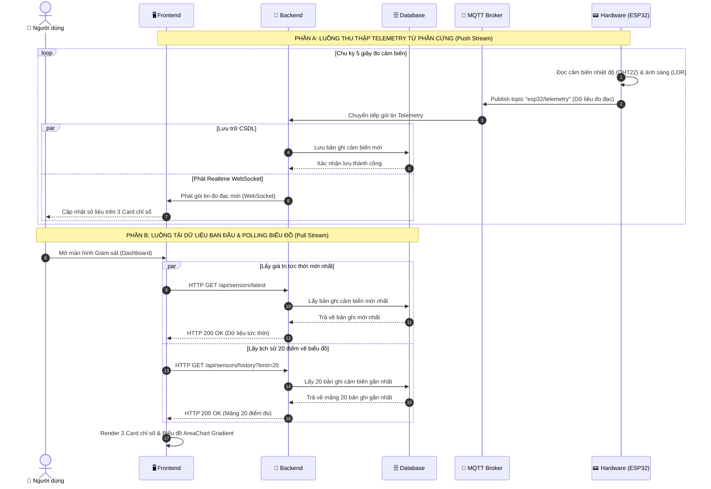

# ĐẶC TẢ CHI TIẾT USE CASE UC02: GIÁM SÁT CẢM BIẾN THỜI GIAN THỰC & BIỂU ĐỒ (REALTIME TELEMETRY)

---

## 1. THÔNG TIN CHUNG

| Thuộc tính | Nội dung |
| :--- | :--- |
| **Mã Use Case** | `UC02` |
| **Tên Use Case** | Giám sát dữ liệu cảm biến thời gian thực & Biểu đồ diện tích (Realtime Sensor Telemetry & AreaChart) |
| **Phân hệ** | Phân hệ Giám sát Trung tâm (Dashboard & Telemetry Ingestion) |
| **Tác nhân (Actors)** | Người dùng / Sinh viên (User), Phần cứng ESP32 (Hardware Sensor Node) |
| **Mục đích** | Thu thập định kỳ dữ liệu đo đạc từ các cảm biến vật lý (Nhiệt độ, Độ ẩm từ DHT22 trên chân GPIO 4; Cường độ ánh sáng từ Quang trở LDR trên chân ADC 34), lưu trữ vào CSDL MongoDB Time-Series, hiển thị trực quan lên 3 Thẻ chỉ số (Sensor Cards) và vẽ Biểu đồ đường diện tích chuyển màu gradient (**AreaChart Gradient**) tự động làm mới độc lập mỗi **5 giây** mà không cần tải lại toàn bộ trang web. |

---

## 2. ĐIỀU KIỆN

### 2.1. Tiền điều kiện (Preconditions)
- Mạch ESP32 đã kết nối WiFi phòng lab và kết nối thành công tới Mosquitto MQTT Broker (port 1883).
- Backend Node.js đã kết nối MongoDB Atlas và đang lắng nghe topic `esp32/telemetry`.
- Trình duyệt người dùng đã mở trang Giám sát trung tâm (`/dashboard` tại `DashboardPage.jsx`).

### 2.2. Hậu điều kiện (Postconditions)
- Dữ liệu đo mới nhất được ghi thành công vào bảng `sensor_data` trong CSDL.
- 3 Thẻ chỉ số cảm biến trên Dashboard hiển thị giá trị mới kèm màu sắc cảnh báo theo ngưỡng.
- Biểu đồ AreaChart cập nhật thêm điểm dữ liệu mới, duy trì tối đa 20 điểm đo gần nhất để đồ thị chuyển động mượt mà.

---

## 3. MÔ TẢ LUỒNG NGHIỆP VỤ (USE CASE FLOWS)

Hệ thống kết hợp giữa **Luồng sự kiện chính (Người dùng giám sát trên giao diện)**, **Luồng thu thập nền tự động (Thiết bị IoT đo và đồng bộ dữ liệu)**, **Luồng cảnh báo ngưỡng** và **Luồng ngoại lệ**:

### 3.1. Luồng sự kiện chính (Basic Flow: Khởi tạo & Giám sát dữ liệu thời gian thực)

| STT | Thực hiện bởi | Hành động |
| :---: | :--- | :--- |
| 1 | Người dùng | Truy cập vào màn hình Giám sát trung tâm (Dashboard). |
| 2 | Hệ thống (Frontend) | Gửi yêu cầu lấy giá trị cảm biến mới nhất và chuỗi dữ liệu lịch sử gần nhất đến máy chủ. |
| 3 | Hệ thống (Backend) | Tiếp nhận yêu cầu, truy vấn Cơ sở dữ liệu để lấy bản ghi đo đạc mới nhất và danh sách các điểm đo lịch sử. |
| 4 | Hệ thống (Backend) | Chuẩn hóa danh sách theo thứ tự thời gian tăng dần và phản hồi dữ liệu về cho giao diện. |
| 5 | Hệ thống (Frontend) | Hiển thị tức thời giá trị lên các thẻ chỉ số (Nhiệt độ, Độ ẩm, Ánh sáng) và dựng Biểu đồ đường diện tích (AreaChart). |
| 6 | Hệ thống (Frontend) | Duy trì cơ chế cập nhật biểu đồ định kỳ và lắng nghe sự kiện thời gian thực để phản ánh liên tục trạng thái môi trường. |

### 3.2. Luồng thu thập & đồng bộ dữ liệu tự động từ IoT (Subflow: Data Ingestion & Push Realtime)

| STT | Thực hiện bởi | Hành động |
| :---: | :--- | :--- |
| 1 | Node cảm biến (ESP32) | Định kỳ theo chu kỳ lấy mẫu, đọc các giá trị đo đạc từ các cảm biến vật lý (DHT22, LDR). |
| 2 | Node cảm biến (ESP32) | Đóng gói dữ liệu đo đạc kèm mốc thời gian thành định dạng chuẩn (JSON). |
| 3 | Node cảm biến (ESP32) | Gửi gói tin dữ liệu lên máy chủ trung gian qua giao thức mạng nhẹ (MQTT Broker). |
| 4 | Hệ thống (Backend) | Nhận thông điệp từ chủ đề (topic) đã đăng ký, thực hiện kiểm tra và lưu trữ bản ghi vào Cơ sở dữ liệu. |
| 5 | Hệ thống (Backend) | Phát sự kiện thời gian thực (qua kênh WebSocket) tới toàn bộ các máy trạm người dùng đang mở trang giám sát. |
| 6 | Hệ thống (Frontend) | Nhận dữ liệu phát tức thời, cập nhật chỉ số trên các thẻ cảm biến mà không cần tải lại trang. |

### 3.3. Luồng cảnh báo vượt ngưỡng an toàn (Alternative Flow: Threshold Alert)

| STT | Thực hiện bởi | Hành động |
| :---: | :--- | :--- |
| 1 | Hệ thống (Frontend/Backend) | So sánh giá trị môi trường đo được với các ngưỡng an toàn đã quy định (ví dụ: nhiệt độ vượt quá 35°C). |
| 2 | Hệ thống (Frontend) | Nếu vượt ngưỡng, tự động đổi màu sắc cảnh báo trên thẻ chỉ số và hiển thị biểu ngữ (Alert banner) cảnh báo nguy cơ quá nhiệt. |
| 3 | Người dùng | Tiếp nhận cảnh báo trực quan để chủ động đưa ra quyết định điều khiển thiết bị ngoại vi (bật quạt/làm mát). |

### 3.4. Luồng xử lý ngoại lệ (Exception Flow: Mất kết nối / Không có dữ liệu)

| STT | Thực hiện bởi | Hành động |
| :---: | :--- | :--- |
| 1 | Hệ thống (Frontend) | Phát hiện mất kết nối mạng hoặc không nhận được phản hồi từ máy chủ / kênh WebSocket. |
| 2 | Hệ thống (Frontend) | Hiển thị thông báo trạng thái ngoại tuyến hoặc giữ nguyên điểm dữ liệu hợp lệ gần nhất, tránh tình trạng treo giao diện. |
| 3 | Hệ thống (Frontend) | Tự động kích hoạt cơ chế thử kết nối lại theo định kỳ cho đến khi đường truyền được tái thiết lập thành công. |

---

## 4. SƠ ĐỒ TUẦN TỰ (SEQUENCE DIAGRAM)




---

## 5. MÔ TẢ TƯƠNG TÁC CƠ SỞ DỮ LIỆU (DATABASE)

| Tên Bảng (Collection) | Thao Tác CRUD | Mô Tả Chi Tiết & Tối Ưu Index |
| :--- | :---: | :--- |
| **`sensor_data`** | `CREATE (insertOne)` | Ghi nhận mỗi lần ESP32 gửi gói tin đo đạc môi trường qua MQTT. |
| **`sensor_data`** | `READ (findOne)` | Truy vấn lấy 01 bản ghi đo đạc có timestamp mới nhất (`sort: { measured_at: -1 }`). |
| **`sensor_data`** | `READ (find & limit)` | Truy vấn lấy 20 bản ghi gần nhất phục vụ vẽ biểu đồ AreaChart: `db.sensor_data.find().sort({ measured_at: -1 }).limit(20)`. |

### Cấu Trúc Schema Bảng `sensor_data`:
```javascript
{
  temperature: { type: Number, required: true }, // Nhiệt độ (°C), ví dụ: 29.4
  humidity: { type: Number, required: true },    // Độ ẩm không khí (%), ví dụ: 68.5
  light: { type: Number, required: true },       // Cường độ ánh sáng (Lux), ví dụ: 520
  measured_at: { type: Date, default: Date.now } // Thời điểm đo (ISO Date UTC)
}
// Index tối ưu: { measured_at: -1 }
```

---

## 6. MÔ TẢ API (RESTFUL API SPECIFICATION)

### 6.1. Bảng Đặc Tả API Lấy Dữ Liệu Cảm Biến Mới Nhất:

| Thành Phần | Chi Tiết |
| :--- | :--- |
| **Endpoint** | `/api/sensors/latest` |
| **HTTP Method** | `GET` |
| **Yêu Cầu Xác Thực (Auth)** | Không bắt buộc |
| **Mô Tả** | Trả về thông số môi trường tức thời mới nhất để hiển thị lên 3 Card Dashboard. |

### Mã Trạng Thái HTTP & Response Mẫu:
| HTTP Status | Trường Hợp | Response Body JSON Mẫu |
| :---: | :--- | :--- |
| **`200 OK`** | Thành công | ```json<br>{<br>  "temperature": 28.5,<br>  "humidity": 68.0,<br>  "light": 520,<br>  "measured_at": "2026-08-18T14:30:00.000Z"<br>}<br>``` |
| **`500 Internal Error`** | Lỗi server/DB | ```json<br>{ "message": "Lỗi truy vấn cơ sở dữ liệu" }<br>``` |

---

### 6.2. Bảng Đặc Tả API Lấy Lịch Sử Điểm Đo Cho Biểu Đồ (AreaChart):

| Thành Phần | Chi Tiết |
| :--- | :--- |
| **Endpoint** | `/api/sensors/history` |
| **HTTP Method** | `GET` |
| **Query Parameters** | `limit`: Số lượng điểm đo cần lấy (Mặc định `20`, ví dụ: `?limit=20`) |
| **Yêu Cầu Xác Thực (Auth)** | Không bắt buộc |
| **Mô Tả** | Trả về mảng các điểm đo theo thứ tự thời gian tăng dần để nạp trực tiếp vào component AreaChart của Recharts. |

### Mã Trạng Thái HTTP & Response Mẫu:
| HTTP Status | Trường Hợp | Response Body JSON Mẫu |
| :---: | :--- | :--- |
| **`200 OK`** | Thành công | ```json<br>[<br>  {<br>    "_id": "66c1f001...",<br>    "temperature": 28.1,<br>    "humidity": 67.5,<br>    "light": 510,<br>    "measured_at": "2026-08-18T14:28:20.000Z"<br>  },<br>  {<br>    "_id": "66c1f002...",<br>    "temperature": 28.5,<br>    "humidity": 68.0,<br>    "light": 520,<br>    "measured_at": "2026-08-18T14:28:25.000Z"<br>  }<br>]<br>``` |
| **`500 Internal Error`** | Lỗi server | ```json<br>{ "message": "Lỗi truy xuất lịch sử cảm biến" }<br>``` |
