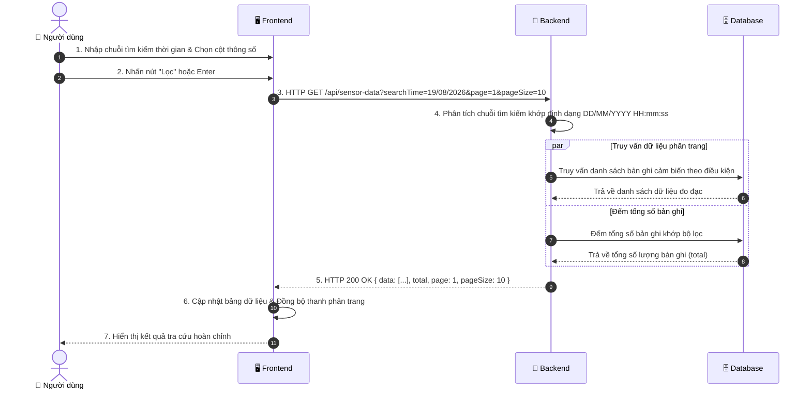

# ĐẶC TẢ CHI TIẾT USE CASE UC03: TRA CỨU & LỌC DỮ LIỆU CẢM BIẾN (SENSOR DATA QUERY)

---

## 1. THÔNG TIN CHUNG

| Thuộc tính | Nội dung |
| :--- | :--- |
| **Mã Use Case** | `UC03` |
| **Tên Use Case** | Tra cứu & Lọc dữ liệu đo đạc cảm biến (Sensor Data Query with Time String Search) |
| **Phân hệ** | Phân hệ Quản lý & Tra cứu Dữ liệu (Data Management) |
| **Tác nhân (Actors)** | Người dùng / Sinh viên (User), Quản trị viên (Admin) |
| **Mục đích** | Cho phép người dùng tra cứu toàn bộ dữ liệu lịch sử đo đạc của các cảm biến trong kho dữ liệu MongoDB; hỗ trợ tìm kiếm thời gian linh hoạt qua **1 ô Input chuỗi thời gian duy nhất** khớp với định dạng hiển thị trong bảng thống kê (`DD/MM/YYYY HH:mm:ss`), chọn hiển thị các cột thông số cảm biến và phân trang bảng dữ liệu với Ant Design Table. |

---

## 2. ĐIỀU KIỆN

### 2.1. Tiền điều kiện (Preconditions)
- Người dùng đã truy cập vào trang Tra cứu dữ liệu cảm biến (`/sensor-data` tại `DataSensorPage.jsx`).
- Bảng `sensor_data` trong cơ sở dữ liệu MongoDB Atlas đã có dữ liệu đo đạc.

### 2.2. Hậu điều kiện (Postconditions)
- Bảng dữ liệu Ant Design hiển thị chính xác danh sách các bản ghi thỏa mãn từ khóa tìm kiếm thời gian và các cột cảm biến được chọn.
- Tổng số bản ghi (`total`) và thông tin phân trang (Trang hiện tại, Số bản ghi/trang) được hiển thị đầy đủ, cho phép người dùng chuyển trang mượt mà.

---

## 3. MÔ TẢ LUỒNG NGHIỆP VỤ (USE CASE FLOWS)

Hệ thống cung cấp cơ chế tra cứu linh hoạt kết hợp giữa **Luồng sự kiện chính (Tra cứu theo chuỗi thời gian & Lọc thông số)**, **Luồng phân trang / thay đổi kích thước trang** và **Các luồng xử lý ngoại lệ**:

### 3.1. Luồng sự kiện chính (Basic Flow: Tra cứu & Lọc dữ liệu cảm biến)

| STT | Thực hiện bởi | Hành động |
| :---: | :--- | :--- |
| 1 | Người dùng | Truy cập vào màn hình Lịch sử dữ liệu cảm biến (`/sensor-data`). |
| 2 | Hệ thống (Frontend) | Tự động gửi yêu cầu lấy danh sách bản ghi cảm biến mới nhất ở trang đầu tiên kèm kích thước mặc định. |
| 3 | Hệ thống (Backend) | Tiếp nhận yêu cầu, truy vấn Cơ sở dữ liệu để lấy danh sách bản ghi đo đạc và tổng số lượng dữ liệu hiện có. |
| 4 | Hệ thống (Frontend) | Hiển thị bảng dữ liệu cảm biến (Nhiệt độ, Độ ẩm, Ánh sáng, Thời gian đo) cùng thanh điều hướng phân trang. |
| 5 | Người dùng | Nhập chuỗi mốc thời gian cần tìm kiếm vào ô tìm kiếm (VD: `19/08/2026`, `15:30`, `19/08/2026 15:30:20`,...) và/hoặc chọn các cột thông số cảm biến hiển thị. |
| 6 | Người dùng | Nhấn nút **"Lọc"** hoặc nhấn phím **Enter** để gửi yêu cầu tra cứu. |
| 7 | Hệ thống (Frontend) | Đóng gói tham số tìm kiếm `searchTime` và gửi HTTP GET request đến máy chủ. |
| 8 | Hệ thống (Backend) | Phân tích chuỗi tìm kiếm, tạo câu truy vấn khớp định dạng thời gian và thực hiện truy vấn đồng thời dữ liệu khớp điều kiện cùng tổng số bản ghi. |
| 9 | Hệ thống (Backend) | Phản hồi danh sách dữ liệu, tổng số bản ghi và thông tin phân trang về cho giao diện người dùng. |
| 10 | Hệ thống (Frontend) | Cập nhật bảng dữ liệu hiển thị theo kết quả tìm kiếm và đồng bộ lại thanh phân trang. |

### 3.2. Luồng phân trang & đổi kích thước trang (Alternative Flow: Pagination)

| STT | Thực hiện bởi | Hành động |
| :---: | :--- | :--- |
| 1 | Người dùng | Nhấp chọn chuyển sang trang khác hoặc thay đổi số lượng bản ghi hiển thị trên mỗi trang (ví dụ: 10, 20, 50 bản ghi/trang). |
| 2 | Hệ thống (Frontend) | Gửi yêu cầu truy vấn đến máy chủ với số trang (`page`) và kích thước trang (`pageSize`) mới, giữ nguyên từ khóa tìm kiếm thời gian đã nhập. |
| 3 | Hệ thống (Backend) | Tính toán độ lệch phân trang (offset/skip), truy vấn dữ liệu tương ứng và trả về cho giao diện. |
| 4 | Hệ thống (Frontend) | Cập nhật lại nội dung bảng dữ liệu theo trang vừa chọn. |

### 3.3. Luồng xử lý ngoại lệ (Exception Flows)

| STT | Mã ngoại lệ | Thực hiện bởi | Hành động |
| :---: | :---: | :--- | :--- |
| 1 | **E1** | Hệ thống (Backend / Frontend) | **Không tìm thấy dữ liệu thoả mãn:** Máy chủ trả về danh sách rỗng (`total = 0`), giao diện hiển thị trạng thái bảng rỗng thông báo không có dữ liệu đo đạc phù hợp. |
| 2 | **E2** | Hệ thống (Backend / Frontend) | **Lỗi kết nối CSDL hoặc máy chủ:** Máy chủ trả về mã phản hồi lỗi hệ thống (HTTP 500), giao diện hiển thị thông báo cảnh báo để người dùng thực hiện lại thao tác. |

---

## 4. SƠ ĐỒ TUẦN TỰ (SEQUENCE DIAGRAM)



---

## 5. MÔ TẢ TƯƠNG TÁC CƠ SỞ DỮ LIỆU (DATABASE)

| Tên Bảng (Collection) | Thao Tác CRUD | Mô Tả Truy Vấn & Index |
| :--- | :---: | :--- |
| **`sensor_data`** | `READ (find, skip, limit)` | Truy vấn danh sách đo đạc theo điều kiện tìm kiếm thời gian chuỗi, sắp xếp mới nhất lên đầu (`sort({ measured_at: -1 })`), phân trang bằng `skip((page-1)*pageSize)` và `limit(pageSize)`. |
| **`sensor_data`** | `READ (countDocuments)` | Đếm tổng số bản ghi thỏa mãn điều kiện tìm kiếm để tính toán số trang hiển thị. |

### Cấu Trúc Khớp Chuỗi Thời Gian (String Matching):
- Khớp chuỗi với định dạng hiển thị `DD/MM/YYYY HH:mm:ss` tại múi giờ Việt Nam (`+07:00`) qua MongoDB `$expr` & `$dateToString`.

---

## 6. MÔ TẢ API (RESTFUL API SPECIFICATION)

### Bảng Đặc Tả API Tra Cứu Dữ Liệu Cảm Biến:

| Thành Phần | Chi Tiết |
| :--- | :--- |
| **Endpoint** | `/api/sensor-data` |
| **HTTP Method** | `GET` |
| **Yêu Cầu Xác Thực (Auth)** | Không bắt buộc |
| **Query Parameters** | - `searchTime` *(String, Optional)*: Chuỗi thời gian cần tìm kiếm (VD: `19/08/2026`, `15:30`, `19/08/2026 15:30:20`)<br>- `page` *(Integer, Default: `1`)*: Chỉ số trang<br>- `pageSize` *(Integer, Default: `10`)*: Số bản ghi mỗi trang |

### Bảng Mã Trạng Thái HTTP & Cấu Trúc Trả Về:

| HTTP Status Code | Tình Huống | Cấu Trúc Response JSON Mẫu |
| :---: | :--- | :--- |
| **`200 OK`** | Tra cứu thành công | ```json<br>{<br>  "data": [<br>    {<br>      "id": "66c1f123...",<br>      "temperature": 29.2,<br>      "humidity": 64.0,<br>      "light": 480,<br>      "measured_at": "2026-08-18T14:35:10.000Z"<br>    }<br>  ],<br>  "total": 1250,<br>  "page": 1,<br>  "pageSize": 10,<br>  "searchTime": "19/08/2026"<br>}<br>``` |
| **`500 Internal Error`** | Lỗi server hoặc lỗi kết nối DB | ```json<br>{ "message": "Lỗi truy vấn cơ sở dữ liệu" }<br>``` |

