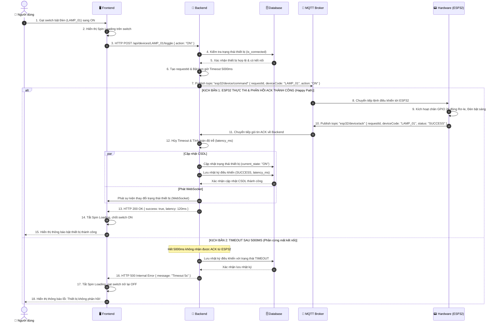

# ĐẶC TẢ CHI TIẾT USE CASE UC04: ĐIỀU KHIỂN THIẾT BỊ & PHẢN HỒI ACK (DEVICE CONTROL & MQTT ACK)

---

## 1. THÔNG TIN CHUNG

| Thuộc tính | Nội dung |
| :--- | :--- |
| **Mã Use Case** | `UC04` |
| **Tên Use Case** | Điều khiển thiết bị phần cứng & Cơ chế phản hồi xác nhận 2 chiều (Device Control with MQTT ACK & Timeout Handling) |
| **Phân hệ** | Phân hệ Điều khiển Thiết bị (Device Management & Actuator Control) |
| **Tác nhân (Actors)** | Người dùng / Sinh viên (User), Phần cứng ESP32 (Hardware Actuator Node) |
| **Mục đích** | Cho phép người dùng điều khiển bật/tắt các rơ-le thiết bị ngoại vi (Đèn `LAMP_01` kết nối chân GPIO 26; Quạt `FAN_01` ở cổng mở rộng dự phòng) từ giao diện Web; áp dụng **cơ chế phản hồi xác nhận hai chiều (Two-way MQTT Acknowledgment - ACK)** kèm bộ đếm thời gian **Timeout 5000ms** để đảm bảo trạng thái hiển thị trên giao diện người dùng đồng bộ 100% với trạng thái vật lý thực tế của thiết bị. |

---

## 2. ĐIỀU KIỆN

### 2.1. Tiền điều kiện (Preconditions)
- Mạch ESP32 đã kết nối WiFi và subscribe vào topic lệnh điều khiển `esp32/device/command`.
- Backend Node.js đã kết nối MQTT Broker và subscribe vào topic phản hồi xác nhận `esp32/device/ack`.
- Người dùng đang mở giao diện Bảng điều khiển thiết bị (`DevicePanel.jsx` trên Dashboard).

### 2.2. Hậu điều kiện (Postconditions)
- **Thành công (Success):** 
  - Rơ-le vật lý trên ESP32 đóng/ngắt mạch tương ứng với lệnh;
  - Bản ghi trạng thái `current_state` của thiết bị trong bảng `devices` được cập nhật;
  - Bản ghi nhật ký mới trong bảng `action_histories` được lưu với trạng thái `SUCCESS` và độ trễ phản hồi `latency_ms`;
  - Switch trên giao diện dừng quay vòng (Spin loading) và chuyển sang trạng thái mới.
- **Thất bại / Quá hạn (Timeout / Failure):**
  - Sau 5000ms không nhận được gói tin ACK từ phần cứng, hệ thống tự động ghi nhật ký trạng thái `TIMEOUT` vào CSDL;
  - Switch trên giao diện tự động hoàn trả lại trạng thái ban đầu và hiển thị thông báo lỗi cảnh báo mất kết nối phần cứng.

---

## 3. MÔ TẢ LUỒNG NGHIỆP VỤ (USE CASE FLOWS)

Hệ thống điều khiển thiết bị áp dụng cơ chế xác nhận phản hồi hai chiều (MQTT ACK) và bộ đếm thời gian Timeout 5s, kết hợp giữa **Luồng tải danh sách thiết bị**, **Luồng sự kiện chính (Điều khiển ACK thành công)** và **Các luồng xử lý ngoại lệ**:

### 3.1. Luồng tải danh sách thiết bị (Load Devices Flow)

| STT | Thực hiện bởi | Hành động |
| :---: | :--- | :--- |
| 1 | Người dùng | Mở màn hình Giám sát trung tâm hoặc Bảng điều khiển thiết bị (Device Panel). |
| 2 | Hệ thống (Frontend) | Gửi yêu cầu `HTTP GET /api/devices` đến máy chủ Backend để lấy danh sách thiết bị. |
| 3 | Hệ thống (Backend) | Truy vấn Cơ sở dữ liệu lấy danh sách các thiết bị đang kích hoạt trong hệ thống. |
| 4 | Hệ thống (Backend) | Trả về danh sách thiết bị kèm thông tin trạng thái hoạt động (ON/OFF) và trạng thái kết nối phần cứng (`is_connected`). |
| 5 | Hệ thống (Frontend) | Hiển thị danh sách thiết bị: Thiết bị có kết nối thật hiển thị Switch điều khiển bình thường; Thiết bị mở rộng chưa kết nối hiển thị nhãn cảnh báo và vô hiệu hóa nút bấm. |

### 3.2. Luồng sự kiện chính: Điều khiển thiết bị & Phản hồi ACK thành công (Basic Flow)

| STT | Thực hiện bởi | Hành động |
| :---: | :--- | :--- |
| 1 | Người dùng | Gạt Switch điều khiển thiết bị (ví dụ: Đèn `LAMP_01`) sang vị trí `ON`. |
| 2 | Hệ thống (Frontend) | Hiển thị trạng thái chờ xử lý (Spin Loading) trên Switch để ngăn thao tác bấm liên tục. |
| 3 | Hệ thống (Frontend) | Gửi yêu cầu `HTTP POST /api/devices/LAMP_01/toggle` kèm lệnh `{ action: "ON" }` lên máy chủ. |
| 4 | Hệ thống (Backend) | Kiểm tra thiết bị hợp lệ, tạo mã định danh yêu cầu `requestId` và khởi tạo bộ hẹn giờ Timeout 5000ms. |
| 5 | Hệ thống (Backend) | Xuất bản thông điệp điều khiển lên MQTT Topic `esp32/device/command`. |
| 6 | Node phần cứng (ESP32) | Nhận lệnh từ Broker, kích hoạt mức logic chân GPIO tương ứng để đóng Rơ-le, bật sáng thiết bị. |
| 7 | Node phần cứng (ESP32) | Đóng gói thông điệp xác nhận (ACK) và xuất bản lên MQTT Topic `esp32/device/ack`. |
| 8 | Hệ thống (Backend) | Nhận gói tin ACK, hủy bộ hẹn giờ Timeout, tính toán độ trễ phản hồi (latency) và cập nhật trạng thái thiết bị trong CSDL. |
| 9 | Hệ thống (Backend) | Lưu bản ghi nhật ký thao tác (`SUCCESS`, độ trễ) và phát sự kiện đồng bộ qua WebSocket. |
| 10 | Hệ thống (Backend) | Phản hồi kết quả thành công HTTP 200 OK về cho Frontend. |
| 11 | Hệ thống (Frontend) | Tắt biểu tượng chờ, chốt vị trí Switch `ON` và hiển thị thông báo điều khiển thành công kèm độ trễ. |

### 3.3. Luồng ngoại lệ: Quá hạn phản hồi phần cứng (Timeout 5000ms Flow)

| STT | Thực hiện bởi | Hành động |
| :---: | :--- | :--- |
| 1 | Hệ thống (Backend) | Sau 5000ms không nhận được gói tin ACK từ thiết bị phần cứng ESP32 (do mất nguồn hoặc mất mạng). |
| 2 | Hệ thống (Backend) | Bộ hẹn giờ Timeout kích hoạt: hủy lệnh chờ, lưu nhật ký thao tác vào CSDL với trạng thái `TIMEOUT`. |
| 3 | Hệ thống (Backend) | Phản hồi mã lỗi HTTP 500 kèm thông báo quá hạn phản hồi về cho giao diện. |
| 4 | Hệ thống (Frontend) | Tắt biểu tượng chờ, tự động gạt Switch trở lại trạng thái ban đầu (`OFF`) và hiển thị thông báo lỗi cảnh báo thiết bị không phản hồi. |

### 3.4. Luồng ngoại lệ: Điều khiển thiết bị chưa kết nối phần cứng (Disabled Device Flow)

| STT | Thực hiện bởi | Hành động |
| :---: | :--- | :--- |
| 1 | Người dùng / Hệ thống | Cố ý gửi yêu cầu điều khiển thiết bị chưa được kết nối vật lý (`is_connected: false`). |
| 2 | Hệ thống (Backend) | Kiểm tra cờ trạng thái kết nối, phát hiện thiết bị là module mở rộng chưa lắp đặt. |
| 3 | Hệ thống (Backend) | Chặn lệnh điều khiển và phản hồi mã lỗi HTTP 400 Bad Request kèm thông báo chi tiết. |
| 4 | Hệ thống (Frontend) | Hiển thị thông báo nhắc nhở người dùng thiết bị chưa được kết nối phần cứng. |

---

## 4. SƠ ĐỒ TUẦN TỰ (SEQUENCE DIAGRAM)




---

## 5. MÔ TẢ TƯƠNG TÁC CƠ SỞ DỮ LIỆU (DATABASE)

| Tên Bảng (Collection) | Thao Tác CRUD | Mô Tả & Điều Kiện |
| :--- | :---: | :--- |
| **`devices`** | `READ (find)` | Lấy danh sách các thiết bị đang kích hoạt: `db.devices.find({ is_active: true })`. |
| **`devices`** | `UPDATE (findOneAndUpdate)` | Cập nhật trạng thái tức thời của thiết bị khi nhận được ACK: `db.devices.findOneAndUpdate({ device_code }, { current_state })`. |
| **`action_histories`** | `CREATE (insertOne)` | Ghi nhận phiên điều khiển (kèm thời gian gửi, thời gian nhận phản hồi, độ trễ `latency_ms` và trạng thái `SUCCESS` hoặc `TIMEOUT`). |

### Cấu Trúc Schema Bảng `devices`:
```javascript
{
  device_code: { type: String, required: true, unique: true }, // VD: "LAMP_01", "FAN_01"
  device_name: { type: String, required: true },               // VD: "Đèn chiếu sáng", "Quạt làm mát"
  device_type: { type: String, enum: ['LAMP', 'FAN', 'PUMP', 'AC', 'OTHER'] },
  pin_relay: { type: Number, required: true },                 // Chân GPIO trên ESP32 (VD: 26, 27)
  is_connected: { type: Boolean, default: true },              // True: Có mạch thật (Đèn), False: Chưa lắp mạch (Quạt)
  current_state: { type: String, enum: ['ON', 'OFF'], default: 'OFF' },
  is_active: { type: Boolean, default: true }
}
```

---

## 6. MÔ TẢ API (RESTFUL API SPECIFICATION)

### 6.1. Bảng Đặc Tả API Lấy Danh Sách Thiết Bị:

| Thành Phần | Chi Tiết |
| :--- | :--- |
| **Endpoint** | `/api/devices` |
| **HTTP Method** | `GET` |
| **Yêu Cầu Xác Thực (Auth)** | Không bắt buộc |
| **Mô Tả** | Trả về danh sách toàn bộ thiết bị ngoại vi trong phòng lab kèm trạng thái kết nối phần cứng và trạng thái ON/OFF hiện tại. |

#### Mã Trạng Thái HTTP & Response Mẫu:
| HTTP Status | Trường Hợp | Response Body JSON Mẫu |
| :---: | :--- | :--- |
| **`200 OK`** | Thành công | ```json<br>[<br>  {<br>    "_id": "66c1f201...",<br>    "device_code": "LAMP_01",<br>    "device_name": "Đèn chiếu sáng",<br>    "device_type": "LAMP",<br>    "pin_relay": 26,<br>    "is_connected": true,<br>    "current_state": "ON",<br>    "is_active": true<br>  },<br>  {<br>    "_id": "66c1f202...",<br>    "device_code": "FAN_01",<br>    "device_name": "Quạt làm mát",<br>    "device_type": "FAN",<br>    "pin_relay": 27,<br>    "is_connected": false,<br>    "current_state": "OFF",<br>    "is_active": true<br>  }<br>]<br>``` |

---

### 6.2. Bảng Đặc Tả API Bật / Tắt Thiết Bị (Toggle Control):

| Thành Phần | Chi Tiết |
| :--- | :--- |
| **Endpoint** | `/api/devices/:deviceCode/toggle` *(Ví dụ: `/api/devices/LAMP_01/toggle`)* |
| **HTTP Method** | `POST` |
| **Yêu Cầu Xác Thực (Auth)** | Khuyến nghị Bearer JWT Token |
| **Request Body** | `{ "action": "ON" }` hoặc `{ "action": "OFF" }` |

#### Bảng Mã Trạng Thái HTTP & Cấu Trúc Trả Về:

| HTTP Status Code | Tình Huống | Cấu Trúc Response JSON Mẫu |
| :---: | :--- | :--- |
| **`200 OK`** | ESP32 thực thi và phản hồi ACK thành công | ```json<br>{<br>  "success": true,<br>  "requestId": "REQ_1723987654_a1b2c",<br>  "deviceCode": "LAMP_01",<br>  "latency": 128,<br>  "message": "ESP32 đã thực thi và phản hồi ACK thành công!"<br>}<br>``` |
| **`400 Bad Request`** | Hành động không hợp lệ hoặc Thiết bị chưa kết nối phần cứng | ```json<br>{<br>  "message": "Thiết bị Quạt làm mát (FAN_01) chưa được kết nối phần cứng. Đây là module mở rộng dự phòng."<br>}<br>``` |
| **`404 Not Found`** | Không tìm thấy mã thiết bị | ```json<br>{<br>  "message": "Không tìm thấy thiết bị có mã LAMP_99"<br>}<br>``` |
| **`500 Internal Error`** | Timeout không nhận được ACK từ phần cứng sau 5s | ```json<br>{<br>  "message": "Timeout: Không nhận được gói tin ACK từ ESP32 sau 5s"<br>}<br>``` |
