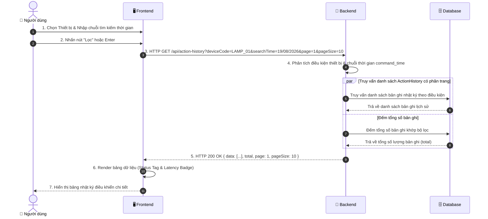

# ĐẶC TẢ CHI TIẾT USE CASE UC05: TRA CỨU NHẬT KÝ LỊCH SỬ ĐIỀU KHIỂN (ACTION HISTORY QUERY)

---

## 1. THÔNG TIN CHUNG

| Thuộc tính | Nội dung |
| :--- | :--- |
| **Mã Use Case** | `UC05` |
| **Tên Use Case** | Tra cứu nhật ký lịch sử điều khiển thiết bị (Device Action History Query) |
| **Phân hệ** | Phân hệ Nhật ký & Giám sát Hệ thống (Audit & Logging) |
| **Tác nhân (Actors)** | Người dùng / Sinh viên (User), Quản trị viên (Admin) |
| **Mục đích** | Cho phép người dùng theo dõi và kiểm toán toàn bộ lịch sử các lệnh bật/tắt thiết bị đã thực hiện trong quá khứ; ghi nhận chi tiết thời gian phát lệnh `command_time`, thời gian nhận xác nhận phản hồi `response_time`, độ trễ vòng lặp truyền tin `latency_ms` và trạng thái kết quả (`SUCCESS`, `TIMEOUT`, `FAILED`). Hỗ trợ lọc theo thiết bị và tìm kiếm thời gian qua **1 ô Input chuỗi thời gian duy nhất** khớp với định dạng bảng (`DD/MM/YYYY HH:mm:ss`). |

---

## 2. ĐIỀU KIỆN

### 2.1. Tiền điều kiện (Preconditions)
- Người dùng đã truy cập vào trang Nhật ký điều khiển (`/action-history` tại `ActionHistoryPage.jsx`).
- Bảng `action_histories` trong cơ sở dữ liệu MongoDB Atlas đã lưu trữ dữ liệu lịch sử các lần tương tác thiết bị.

### 2.2. Hậu điều kiện (Postconditions)
- Bảng Ant Design Table hiển thị danh sách nhật ký điều khiển được sắp xếp mới nhất lên đầu (`sort({ command_time: -1 })`), kèm nhãn Tag màu sắc trực quan (Xanh lá: `SUCCESS`, Đỏ: `TIMEOUT`/`FAILED`, Cam: Lệnh `ON`, Xám: Lệnh `OFF`).
- Người dùng dễ dàng phân tích độ trễ phản hồi phần cứng và kiểm tra tính ổn định của đường truyền MQTT Broker.

---

## 3. MÔ TẢ LUỒNG NGHIỆP VỤ (USE CASE FLOWS)

Hệ thống cung cấp cơ chế tra cứu kết hợp giữa **Luồng sự kiện chính (Lọc theo thiết bị & Tra cứu chuỗi thời gian)**, **Luồng phân trang / kiểm tra độ trễ** và **Các luồng xử lý ngoại lệ**:

### 3.1. Luồng sự kiện chính (Basic Flow: Tra cứu nhật ký điều khiển)

| STT | Thực hiện bởi | Hành động |
| :---: | :--- | :--- |
| 1 | Người dùng | Điều hướng đến trang Nhật ký điều khiển (`/action-history`). |
| 2 | Hệ thống (Frontend) | Tự động gửi yêu cầu lấy 10 bản ghi nhật ký mới nhất ở trang đầu tiên: `GET /api/action-history?page=1&pageSize=10`. |
| 3 | Hệ thống (Backend) | Truy vấn Cơ sở dữ liệu và trả về danh sách lịch sử điều khiển gần nhất kèm tổng số lượng bản ghi. |
| 4 | Hệ thống (Frontend) | Hiển thị bảng dữ liệu nhật ký điều khiển kèm các thẻ trạng thái và thanh phân trang. |
| 5 | Người dùng | Chọn thiết bị cần lọc (`Tất cả thiết bị`, `Đèn`, `Quạt`) và/hoặc nhập chuỗi mốc thời gian cần tìm (VD: `19/08/2026`, `15:30`). |
| 6 | Người dùng | Nhấn nút **"Lọc"** hoặc nhấn phím **Enter** để gửi yêu cầu tra cứu. |
| 7 | Hệ thống (Frontend) | Đóng gói các tham số lọc (`deviceCode`, `searchTime`) và gửi HTTP GET request đến máy chủ. |
| 8 | Hệ thống (Backend) | Phân tích điều kiện lọc thiết bị và chuỗi thời gian trên trường `command_time`, thực hiện truy vấn đồng thời danh sách bản ghi và đếm tổng số. |
| 9 | Hệ thống (Backend) | Phản hồi danh sách dữ liệu nhật ký, tổng số lượng và thông tin phân trang về cho giao diện. |
| 10 | Hệ thống (Frontend) | Cập nhật bảng nhật ký hiển thị theo kết quả tìm kiếm và đồng bộ lại thanh phân trang. |

### 3.2. Luồng phân trang & kiểm tra độ trễ (Alternative Flow: Pagination & Latency)

| STT | Thực hiện bởi | Hành động |
| :---: | :--- | :--- |
| 1 | Người dùng | Nhấp chuyển trang hoặc thay đổi số lượng bản ghi hiển thị trên mỗi trang. |
| 2 | Hệ thống (Frontend) | Gửi yêu cầu truy vấn đến máy chủ với số trang (`page`) và kích thước (`pageSize`) mới, giữ nguyên thiết bị và chuỗi thời gian đã lọc. |
| 3 | Hệ thống (Backend) | Tính toán độ lệch phân trang (skip), truy vấn dữ liệu tương ứng và trả về cho giao diện. |
| 4 | Hệ thống (Frontend) | Cập nhật nội dung bảng dữ liệu; hiển thị độ trễ `latency_ms` trực quan (mili-giây) giúp người dùng kiểm toán chất lượng đường truyền. |

### 3.3. Luồng xử lý ngoại lệ (Exception Flows)

| STT | Mã ngoại lệ | Thực hiện bởi | Hành động |
| :---: | :---: | :--- | :--- |
| 1 | **E1** | Hệ thống (Backend / Frontend) | **Không tìm thấy dữ liệu lịch sử:** Nếu khoảng thời gian hoặc thiết bị chọn chưa từng có thao tác điều khiển nào, máy chủ trả về danh sách rỗng (`total = 0`), giao diện hiển thị trạng thái bảng rỗng (Empty State). |
| 2 | **E2** | Hệ thống (Backend / Frontend) | **Lỗi kết nối CSDL:** Máy chủ trả về mã phản hồi lỗi HTTP 500, giao diện hiển thị thông báo lỗi để người dùng thử lại. |

---

## 4. SƠ ĐỒ TUẦN TỰ (SEQUENCE DIAGRAM)



---

## 5. MÔ TẢ TƯƠNG TÁC CƠ SỞ DỮ LIỆU (DATABASE)

| Tên Bảng (Collection) | Thao Tác CRUD | Mô Tả & Điều Kiện Truy Vấn |
| :--- | :---: | :--- |
| **`action_histories`** | `READ (find, skip, limit)` | Truy vấn danh sách lịch sử lệnh theo mã thiết bị và chuỗi thời gian phát lệnh `command_time`, sắp xếp mới nhất lên đầu (`sort({ command_time: -1 })`), phân trang bằng `skip` và `limit`. |
| **`action_histories`** | `READ (countDocuments)` | Đếm tổng số bản ghi thỏa mãn bộ lọc để phục vụ phân trang. |

### Cấu Trúc Schema Bảng `action_histories`:
```javascript
{
  device_code: { type: String, required: true },               // Mã thiết bị (VD: "LAMP_01")
  device_name: { type: String, required: true },               // Tên thiết bị (VD: "Đèn chiếu sáng")
  action: { type: String, enum: ['ON', 'OFF'], required: true },// Lệnh thực hiện
  command_time: { type: Date, required: true },                // Thời điểm gửi lệnh đi
  response_time: { type: Date },                               // Thời điểm nhận được gói tin ACK
  latency_ms: { type: Number },                                // Độ trễ tính toán = response_time - command_time
  status: { 
    type: String, 
    enum: ['SUCCESS', 'FAILED', 'TIMEOUT'], 
    default: 'SUCCESS' 
  },
  created_at: { type: Date, default: Date.now }
}
```

---

## 6. MÔ TẢ API (RESTFUL API SPECIFICATION)

### Bảng Đặc Tả API Tra Cứu Nhật Ký Lịch Sử Điều Khiển:

| Thành Phần | Chi Tiết |
| :--- | :--- |
| **Endpoint** | `/api/action-history` |
| **HTTP Method** | `GET` |
| **Yêu Cầu Xác Thực (Auth)** | Không bắt buộc |
| **Query Parameters** | - `deviceCode` *(String, Optional)*: Mã thiết bị cần lọc (`LAMP_01`, `FAN_01` hoặc `ALL`)<br>- `searchTime` *(String, Optional)*: Chuỗi thời gian cần tìm kiếm (VD: `19/08/2026`, `15:30`)<br>- `page` *(Integer, Default: `1`)*: Trang hiện tại<br>- `pageSize` *(Integer, Default: `10`)*: Số bản ghi trên mỗi trang |

### Bảng Mã Trạng Thái HTTP & Cấu Trúc Trả Về:

| HTTP Status Code | Tình Huống | Cấu Trúc Response JSON Mẫu |
| :---: | :--- | :--- |
| **`200 OK`** | Tra cứu thành công | ```json<br>{<br>  "data": [<br>    {<br>      "id": "66c1f301...",<br>      "device_code": "LAMP_01",<br>      "device_name": "Đèn chiếu sáng",<br>      "action": "ON",<br>      "command_time": "2026-08-18T14:40:00.000Z",<br>      "response_time": "2026-08-18T14:40:00.125Z",<br>      "latency_ms": 125,<br>      "status": "SUCCESS"<br>    }<br>  ],<br>  "total": 85,<br>  "page": 1,<br>  "pageSize": 10,<br>  "searchTime": "19/08/2026"<br>}<br>``` |
| **`400 Bad Request`** | Sai tham số query | ```json<br>{ "message": "Tham số tìm kiếm không hợp lệ" }<br>``` |
| **`500 Internal Error`** | Lỗi kết nối CSDL | ```json<br>{ "message": "Lỗi truy vấn cơ sở dữ liệu" }<br>``` |
